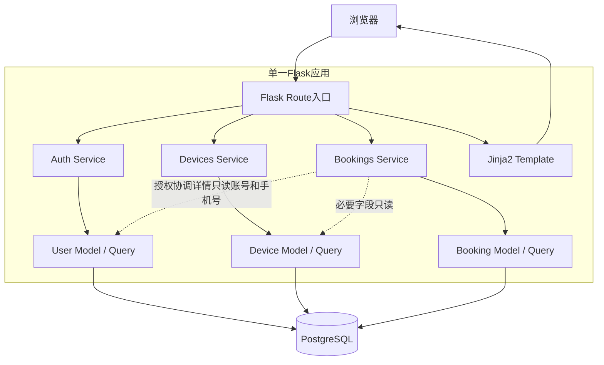
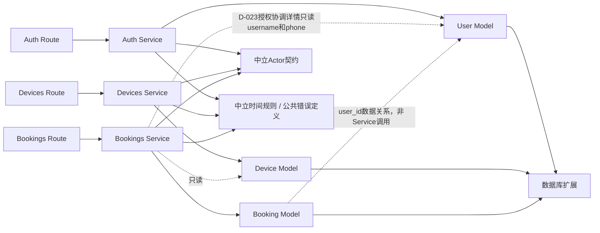
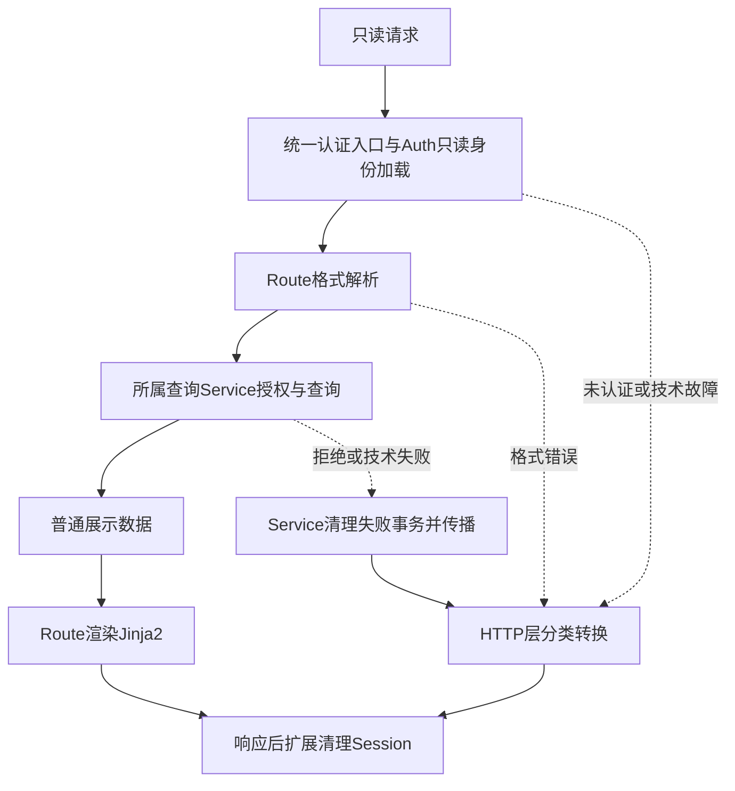
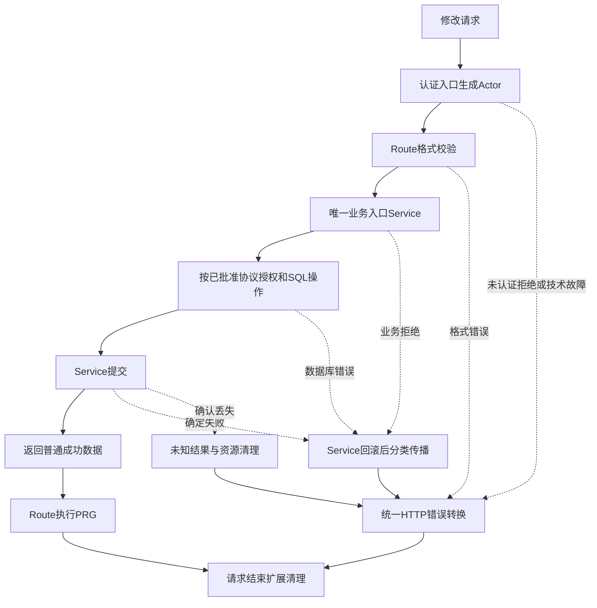
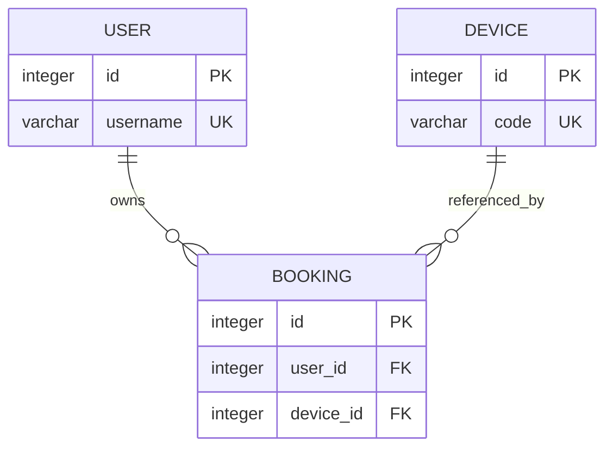

# LabBooking 架构设计

本文是专题一～五已批准设计的当前契约；专题六进行导航、追溯及一致性整理，最终交付评审尚未完成。设备协调见ADR-004，字段/时间/唯一性等D-011～015决定已在正文及Spine落实。团队评审、具体环境兼容及实施验证待完成，不以设计收口替代测试或整份Architecture验收。

当前状态导读：专题三已由D-027/028及A最终收口确认完成架构设计，见“专题三最终收口”与ADR-007。前部旧轮次和ADR-001～006中“认证组件/Route/HTTP未定”等为当时状态，现以专题三正式设计为准，不表示当前仍未决定；历史ADR原文保留。整份Architecture仍待其余专题和团队总评审，不因专题三收口标记全项目完成。

专题四现由D-029及下文集中流程收口；code首尾空白已批准显式拒绝，前部旧章节中的待定描述不再代表当前状态。专题四同样仅完成设计，非实现或测试通过。

专题五由D-030收口版本系列、驱动、运行保护及NFR验收设计；旧段落中“版本/环境/实施计划待定”按专题五当前契约理解，精确版本、参数及实际验证仍待完成。历史Decision Log与ADR原文不改，当前进行专题六文档整理，最终门禁与团队批准未完成。

## 团队评审导航

本文正文表达当前契约；Decision Log/memlog保留过程，ADR-001～008原文不改。具体实现、测试和团队批准均不得由文档整理替代。

| 阅读目标 | 位置 |
| --- | --- |
| 系统与模块、依赖、目录 | [专题一](#arch-system) |
| 请求、返回及事务责任 | [请求契约](#arch-request)；ADR-003/006 |
| 三实体完整字段 | [User](#db-user)、[Device](#db-device)、[Booking](#db-booking) |
| ERD、外键与历史保护 | [关系完整性](#db-relations) |
| 排序、分页及筛选 | [查询契约](#db-query)、[专题三](#security-contract) |
| 认证、安全、Route、权限和HTTP | [专题三](#security-contract)；ADR-007 |
| 创建、取消、设备及错误流程 | [专题四](#business-flows)；ADR-004/005 |
| 版本、运行、迁移与NFR验收 | [专题五](#runtime-nfr)；ADR-001/002 |
| 全部需求与交接责任 | [15 FR＋3 NFR追溯表](#requirements-map) |
| 六专题状态 | [进度表](#progress) |
| ADR与当前约束 | 下文ADR-001～008；[Spine](ARCHITECTURE-SPINE.md) AD-1～8 |

ADR目录：001迁移；002 PostgreSQL；003数据库Session；004设备协调；005取消协调；006请求返回；007浏览器安全；008轻量分层单体。ADR历史中的“未定”由对应当前正文收口，不倒改当时记录。

<a id="arch-system"></a>

## 专题一：系统整体架构

专题一七项决定由 A 于2026-11-17最终确认；团队评审、实现和测试待完成。Service返回契约见后续请求章节；HTTP映射与认证见专题三，字段契约见专题二；具体实现与验证待完成。

### 系统组成与分层职责

浏览器访问一个 Flask 应用，页面由 Jinja2服务端渲染；应用使用 SQLAlchemy/PostgreSQL持久化。Auth、Devices、Bookings是同一应用内的业务模块，不是独立部署服务。

| 部分 | 职责 | 边界 |
| --- | --- | --- |
| Route | 所属模块HTTP入口，调用Service，组织页面响应 | 不直接访问数据库 |
| Service | 本模块业务规则、具体授权与已批准事务 | 不调用其他业务Service |
| Model/Query | 数据映射和查询、数据库约束表达 | 不反向导入Route/Service，不自行拥有业务提交 |
| PostgreSQL | 持久化、锁、事务和最终完整性 | 协议遵守ADR-004/005 |
| Template | 展示准备好的页面数据 | 不查询或隐式加载ORM |
| 公共组件 | Actor、数据库扩展、统一时间规则及公共错误定义 | 不依赖具体业务模块 |



图示不表示Route可任意跨模块调用；各HTTP入口调用所属Service。认证入口与请求职责链见本文专题一请求与返回部分，认证采用Flask-Login，安全契约见专题三及ADR-007。

### 模块职责与数据所有权

| 模块 | 拥有与写入的数据 | 业务职责与边界 |
| --- | --- | --- |
| Auth | User、身份与角色数据 | 请求身份加载只读，生成可信Actor；预设账号通过初始化流程维护，不增加注册或用户管理功能 |
| Devices | Device | 设备查询、资料维护及启停，管理员设备Route归此模块；不修改预约 |
| Bookings | Booking，通过user_id关联User | 创建、取消、状态及资格判断、可用性、个人历史、管理员全部及受影响预约查询 |

Bookings只读Device必要字段，用于设备存在/启用检查及预约查询展示；创建必须使用ADR-004的锁定字段查询，不能以普通展示查询替代。不得修改Device。管理员预约查询默认只使用必要预约人标识，不开放任意User个人信息、凭据读取。具体展示字段留查询/API专题。

管理员是权限角色和页面入口，不是第四个业务模块；不建立Admin Service。取消继续遵守ADR-005，管理员不得代取消。

### 模块依赖关系



箭头表示允许依赖，不要求每个模块都使用所有公共定义；User外键关系不表示Bookings获得任意User读取或写入权限，也不要求模型双向Python导入。

| 关系 | 允许 | 禁止 |
| --- | --- | --- |
| Route→Service | 所属模块Service | 绕过Service访问数据库 |
| Service→Model/Query | 本模块数据；Bookings只读Device必要字段；D-023授权具体预约协调详情只读对应User.username/phone | 调其他业务Service、越权跨模块写入、任意User查询 |
| 管理员入口 | Devices设备管理；Bookings预约管理 | 独立Admin业务规则或Admin Service |
| Model | 数据映射、关系和数据库扩展 | 反向依赖Route/Service |
| 公共组件 | 被各模块使用 | 导入具体业务模块、承担业务所有权 |
| Template | 页面展示 | SQL查询、隐式ORM加载 |
| 模块导入 | 单向依赖，按需引用 | 循环依赖、业务模块反向导入应用装配入口 |

### 应用装配与最小目录

统一 create_app()负责配置加载、扩展初始化、三个模块Route注册及错误处理注册，并支持测试配置。扩展先定义后初始化；应用装配是组合入口，不新增业务层。错误定义放置与专题一请求与返回部分返回契约已确认，HTTP映射见专题三；异常类的代码组织交B落实，不改变返回契约。

```text
labbooking/
  __init__.py          # create_app，应用装配
  config.py           # 配置入口，具体配置项后续确定
  extensions.py       # Flask-SQLAlchemy数据库扩展
  actor.py            # 中立身份契约
  time_rules.py       # 统一时段和业务时间规则
  errors.py           # 中立公共错误定义，具体契约后续确定
  auth/
    __init__.py
    routes.py
    services.py
    models.py         # User
  devices/
    __init__.py
    routes.py         # 包含管理员设备入口
    services.py
    models.py         # Device
  bookings/
    __init__.py
    routes.py         # 包含管理员预约入口
    services.py
    models.py         # Booking
  templates/
  static/
migrations/           # 已选Alembic
tests/               # 测试位置；本轮不创建代码
```

以上为最小组织说明，不表示文件已创建；文件名不构成新增业务抽象。查询复杂或复用后可提取本模块查询函数，不预建Repository基类。账号初始化的具体命令、认证接入、模型关系具体导入语法及测试布局留相应专题/实现确定。

### 扩展边界与依据

当前不引入Repository基类、Unit of Work、消息队列、微服务或依赖注入容器；只有真实复杂度或明确新需求出现后才评估增加抽象。保持现有技术及ADR-004/005协议。

| 需求要求 | 已确认边界 | 后续落实/验证（待完成） |
| --- | --- | --- |
| FR-AUTH-01/02、NFR-03：可信身份与授权 | Auth拥有身份，业务Service授权 | B实现身份入口，C验证伪造/越权及合法配对 |
| FR-DEV-01/02/03：设备查询维护 | Devices独占Device，管理员入口归Devices | 检查数据写入归属与角色权限 |
| FR-BOOK-01～07：预约流程和记录 | Bookings拥有Booking，只读Device | 按ADR-004/005实现验证，禁止绕过Service |
| FR-ADM-01/02/04：管理查询和代取消禁止 | Bookings管理预约查询，最小预约人标识 | 检查查询范围、个人信息不泄露、管理员代取消拒绝 |

依据：D-011、D-012、D-018及A本轮七项最终确认；Context R-15～R-20与Spine模块约束部分同步。不新增D/ADR；团队评审、代码与测试均待完成。

<a id="arch-request"></a>

## 专题一补充：请求处理流程与 Service 返回契约

专题一请求与返回部分由A于2026-11-17批准，来源D-022/ADR-006。团队评审、代码和测试待完成；不改变ADR-003～005。

### 请求职责链

| 步骤 | 责任方 | 约束 |
| --- | --- | --- |
| 验证登录会话、只读加载身份 | HTTP认证保护入口调用Auth身份加载 | 生成可信Actor，显式交给业务Service；业务Service不调用Auth |
| 未认证处理 | HTTP认证入口 | 受保护GET引导登录，修改拒绝、不重放POST；认证数据库故障为技术错误 |
| HTTP解析与格式 | Route | 必填、格式、类型转换，不查数据库，不代替业务检查 |
| 具体授权与资格 | 所属业务Service | 角色、所有权、资源状态及并发重检；遵守ADR-004/005 |
| SQL与修改事务 | Service使用Model/Query | 修改请求单一事务拥有者，Service提交或失败回滚 |
| 正常结果 | Service→Route | 普通数据，不返回ORM隐式查询依赖或Flask Response |
| 成功HTTP响应 | Route | GET渲染Jinja2，修改提交成功后PRG |
| 错误HTTP响应 | 统一HTTP错误处理 | 安全诊断/映射，不接管业务事务、不自动重试 |
| 最终资源清理 | Flask-SQLAlchemy | 上下文结束清理；不等同成功提交 |

业务Service接受明确参数与Actor；Route格式通过不等于业务合法。Template不查询或隐式加载ORM。分页、字段、认证及安全设计见专题二/三；具体配置按专题五落实。

### 读写请求流程





### 返回、异常与HTTP边界

- 正常查询/修改返回普通数据；预期业务拒绝抛轻量BusinessError，不建立通用结果对象框架。
- BusinessError只表达业务标识与安全信息；HTTP状态码、模板和重定向由HTTP侧决定。业务类别和HTTP映射见专题三，具体类继承及代码命名交B落实。
- D-015目标唯一索引冲突回滚后转预约冲突；锁超时、死锁及其他数据库错误是技术失败，内部保留诊断，不自动重试。
- 提交确认丢失为结果未知，不等于确定回滚、不自动重试；遵循共用异常与并发验证原则。
- 错误处理器只转换HTTP与安全诊断，不提交/回滚业务、不再调业务Service。修改失败由Service及时回滚；认证或格式提前拒绝未进入业务时不提交，由扩展结束未提交只读事务。只读Service数据库失败及时清理后传播，不伪装空结果。
- GET成功Route渲染，修改成功才PRG；业务拒绝、技术失败、未知分别表达。HTTP码和Route表按专题三；具体页面布局交B落实；不将错误渲染成成功或重放失败POST。

<a id="db-user"></a>

## 专题二：数据库设计——User联系方式（D-023）

状态：A已最终确认业务及访问边界；团队评审、实现和测试待完成。来源为PRD及A转达的需求负责人反馈，不表示PRD已修改。专题一的User所有权保持；以下补充明确的受限读取，不开放任意个人资料读取。

### 字段契约及批准边界

| 项目 | 已批准内容 | 尚待技术审查 |
| --- | --- | --- |
| User.phone | 仅中国大陆手机号；所有预设账号必填、NOT NULL、无默认、不设UNIQUE，允许同号；不作登录凭据；D-024确认VARCHAR(11) | 正则候选的PostgreSQL表达、CHECK名称、迁移实现 |
| User其他字段 | 预设账号标识识别人，不增加真实姓名、邮箱或短信验证；完整字段见下方D-024 | username ASCII CHECK待账号核查；scrypt已批准，参数和约束表达待落实 |
| 数据关联 | Booking.user_id关联保持；手机号不进入通用Actor、不复制到Booking | 具体模型及查询语法留实现 |

D-024已批准VARCHAR(11)，基本格式正则仍是设计候选，其PostgreSQL约束表达待核查。初始化必须检查号码存在和基本格式，拒绝空串或虚构占位；格式合格不证明真实存在或归属已验证。

### User完整字段契约（D-024）

A已确认以下五字段；团队评审、实现及测试待完成。类型、长度和存储机制是架构选择，不是PRD指定。

| 字段 | PostgreSQL类型 | NULL | UNIQUE | 默认/生成 | 约束及边界 |
| --- | --- | --- | --- | --- | --- |
| id | INTEGER | 否 | PRIMARY KEY | GENERATED ALWAYS AS IDENTITY | 内部稳定标识，不承诺连续或代表提交顺序 |
| username | VARCHAR(64) | 否 | 是 | 无 | 登录输入去首尾空白、统一小写；库内只保存规范小写账号；ASCII字符CHECK尚未批准 |
| password_hash | TEXT | 否 | 否 | 无 | 非空白，完整密码哈希；不保存明文、不截断或规范化哈希；算法为Werkzeug scrypt，参数交B |
| role | VARCHAR(16) | 否 | 否 | 无 | CHECK仅允许user、admin；无角色表 |
| phone | VARCHAR(11) | 否 | 否 | 无 | 11位国内格式，不存+86/空格/连字符；应用及数据库基本格式校验，无手机号查询索引 |

Booking.user_id采用INTEGER保持类型一致；正式外键已由D-026批准，ON DELETE RESTRICT、非延迟且无ON UPDATE CASCADE。username规范化流程须在登录和初始化一致；规范化重名报告，不覆盖已有账号。未找到实际预设账号清单，故不得将ASCII小写字母、数字、下划线限制写成强制CHECK，也不得擅自生成或修改账号。phone的^1[3-9][0-9]{9}$为设计候选，具体PostgreSQL正则、CHECK命名及迁移待核查；不证明真实归属。password_hash非空白校验的具体表达待实现核对，哈希采用ADR-007的scrypt，具体参数待B落实。

| 需求要求 | 架构决定 | B落实（待完成） | C验证（待执行） |
| --- | --- | --- | --- |
| FR-AUTH-01：预设账号及有效凭据 | 唯一规范username及完整哈希 | 五字段模型、初始化与人工审查迁移 | 唯一/规范化、空白哈希、结构约束；账号字符清单另核 |
| FR-AUTH-02、NFR-03：可信角色和信息保护 | role合法值、服务端授权 | CHECK与Actor/Service规则，不向展示层给哈希 | 非法role拒绝；伪造角色及越权拒绝，合法访问配对 |
| FR-BOOK-02/04/05：稳定所有权 | User.id与Booking.user_id同型 | INTEGER正式外键、ON DELETE RESTRICT，按D-026 | 类型一致与所有权正确，不能用username/phone替代用户ID |
| FR-ADM-01/02及D-023：识别人并受限协调 | username与phone分工 | 仅授权详情读必要字段 | 普通查询无号码，详情合法读取，无凭据泄露 |

来源：[Decision Log](../../decision-log.md) D-024；规则见[Context](../../project-context.md) R-32～R-35。约束命名、迁移实现及账号兼容性待落实；算法与删除动作分别按ADR-007、D-026；不新增字段/ADR，不重开D-023。

### 模块与访问边界

- Auth拥有User，负责本人完整手机号的只读查询及初始化/维护边界。身份加载仍只读、不提交，不提供应用内手机号修改。
- Bookings负责管理员预约协调详情：Service验证可信Actor管理员身份、目标预约访问资格，再按该Booking.user_id只读对应User.username/phone；不调用Auth Service、不写User、不读password_hash、不任意查询用户。专题一原“默认必要预约人标识”继续适用于列表，本节限定详情读取例外。
- 协调详情直接展示完整手机号，不做掩码或二次展开。普通预约列表、设备列表、可用性查询、冲突及未授权响应不包含手机号，不可先传给浏览器再隐藏。
- 普通用户只可查看本人完整手机号；用户及管理员都不能通过应用功能修改。Devices不新增联系方式职责，Route调用所属Service，Template仅展示授权后的普通数据，不查数据库或隐式加载。
- 需求负责人提供预设账号及号码，初始化全部校验且失败不留部分账号；后续仅指定系统维护人员变更，查询使用当前号码。真实号码不进入公开Git、普通测试数据、错误日志或测试截图，自动化测试用合成数据。
- 无注册、个人资料管理、手机号修改页面/接口或短信验证；不再安排该修改功能的密码重验或CSRF，系统通用安全设计按专题三/ADR-007。D-018事务和ADR-004/005协议不变。

### 需求追溯及验证责任

| 需求要求 | 架构决定 | B实现（待完成） | C验证（待执行） |
| --- | --- | --- | --- |
| FR-AUTH-01及正式反馈：预设账号、保存联系方式 | User保存必填非唯一phone，初始化维护 | 非空/无默认，格式及完整初始化校验 | 缺失、空值、非法格式拒绝；同号允许；失败无部分账号 |
| FR-AUTH-02、NFR-03：服务端授权及信息保护 | 本人只读，管理员具体预约授权 | Actor与Service检查，必要字段投影 | 合法访问配对越权/未认证拒绝；无修改入口 |
| FR-ADM-01/02：支持协调、不默认展示联系方式 | 列表排除，授权详情完整展示 | Bookings按预约关联受限只读User | 列表无号码，详情有号码；无任意用户读取或代修改 |
| FR-BOOK-03/07：冲突与可用性不泄露信息 | 这些响应完全排除phone | 返回安全普通数据，错误及日志无真实号码 | 检查响应/模板/错误及证据，不以样式隐藏代替排除 |
| FR-DEV-02、FR-BOOK-04/06及正式反馈：历史关联保留 | 显示设备当前名称/位置，不新增资料快照 | 保留device_id及原预约时间快照 | 设备编辑后显示当前资料，预约自身和时间快照不变 |

User字段已由D-024细化；ASCII CHECK、号码格式约束表达和维护流程待落实；Route/HTTP及安全原则已由专题三明确；所有实施及测试待完成。来源：[Decision Log](../../decision-log.md) D-023/024；编码规则：[Context](../../project-context.md) R-27～R-35。不新增ADR，不改变D-013～015、D-018/019/021/022。

<a id="db-device"></a>

## 专题二：数据库设计——Device完整字段契约（D-025）

A已正式批准字段及业务约束；团队评审、实现和测试待完成。PRD要求业务信息和行为，本节类型/长度/默认策略是架构选择，不修改PRD或既有ADR。

### 实体与字段

| 字段 | PostgreSQL类型 | NULL | UNIQUE | 默认/生成 | 约束及业务含义 |
| --- | --- | --- | --- | --- | --- |
| id | INTEGER | 否 | PRIMARY KEY | GENERATED ALWAYS AS IDENTITY | 内部稳定设备标识，预约关联及锁定目标 |
| code | VARCHAR(64) | 否 | 全表唯一 | 无 | 业务编号，拒绝空串/纯空白；大小写敏感精确比较，保留原大小写，创建后不可修改 |
| name | VARCHAR(128) | 否 | 否 | 无 | 名称，拒绝空串/纯空白，管理员可修改 |
| location | VARCHAR(128) | 否 | 否 | 无 | 位置，拒绝空串/纯空白，管理员可修改，无Location表 |
| status | VARCHAR(16) | 否 | 否 | 无 | CHECK仅Available、Disabled，新增显式提供，不改现有状态名 |

Device仅上述五字段，不增描述/型号/停用原因。Booking.device_id使用INTEGER，与Device.id一致；正式外键与删除保护按D-026及三实体关系章节。

### 编号、修改及关联边界

- Devices拥有并写入Device，管理员设备入口调用Devices Service；Bookings仅按既有规则读必要字段，不修改设备。code唯一与不可修改分别保护：唯一约束阻止重复占用，Devices Service拒绝更改既有code；UNIQUE或普通行内CHECK不等于数据库不可变保护。是否增加数据库级不可变机制仍待设计，不宣称已实现。
- code明确区分大小写，不自动大写/小写，不使用大小写不敏感唯一索引。D-029已批准首尾空白显式拒绝，不自动trim或改写；拒绝空串/纯空白是已批准规则。实际编号清单未找到，字符白名单不擅自增加，兼容性不宣称通过。
- 不物理删除设备；停用不释放编号，不能把相同code分配给另一Device记录。维护操作不得据此绕过编号保护。
- name/location可由管理员修改；历史Booking保留原device_id，展示设备当前名称、位置及状态，不新增设备资料快照、不改预约状态或时间快照。展示查询按当前资料准备普通数据，不使用隐式模板查询。
- 状态合法值、NOT NULL和唯一性不替代授权、锁或事务。创建继续ADR-004的Device FOR SHARE锁定字段查询；停用继续Available→Disabled条件UPDATE及既有错误分类。资料更新也可能等待同一设备行锁，不新增锁模式或自动重试。
- 索引当前仅主键及code UNIQUE所需索引，不额外重复建code索引；name/location/status等完整查询索引留查询设计及NFR-02验证。索引列表不是性能已达标结论。

### 需求追溯与实现验证

| 需求要求 | 架构决定 | B实现（待完成） | C验证（待执行） |
| --- | --- | --- | --- |
| FR-DEV-01/02：设备标识、名称、位置和状态 | 五字段契约、显式业务值 | 模型及人工审查迁移，拒绝NULL/空白/非法状态 | 实际结构检查，缺失/空白/非法值拒绝，同名同位置允许 |
| FR-DEV-02：标识唯一且创建后不可改 | code全表、大小写敏感唯一；Service拒绝改号 | 精确比较规则及唯一约束，不用大小写不敏感索引 | 相同code拒绝，停用code仍占用；仅大小写不同允许；改号拒绝无部分修改 |
| FR-DEV-02、FR-BOOK-04及正式反馈：可改资料、历史关联保留 | name/location可改，历史显示当前资料 | 原Device.id关联，不建资料快照 | 修改后历史显示当前值，Booking自身及快照不变 |
| FR-DEV-03、FR-BOOK-02/07、FR-ADM-02：启停及受影响预约 | status沿用两值，不隐式改预约 | 原ADR-004及只读查询 | 两种竞争顺序、回滚、停用仍可见且原预约保留 |
| NFR-02/03：性能和授权 | 暂不猜测额外索引，授权留Service | 管理员操作校验及按查询设计优化 | 普通用户写入拒绝、合法配对；后续实际列表性能验证 |

code首尾空白按D-029显式拒绝，不新增字符白名单；实际编号兼容待核查；待核查：精确比较排序规则/表达、非空白CHECK及命名、不可变数据库机制、迁移细节。正式外键/删除动作按D-026；额外查询索引留真实执行计划评估。来源：[Decision Log](../../decision-log.md) D-025；[Context](../../project-context.md) R-36～R-40。所有实现和测试待完成，不新增技术决定，Booking契约见下节。

<a id="db-booking"></a>

## 专题二：数据库设计——Booking完整字段契约

A已批准以下字段及Service写入边界，并明确本轮作为既有D-013/014/015等决定的技术细化，不新增Decision Log或ADR，不创建D-026。依据还包括D-018/019/021/022/023/024/025及ADR-001～006；本轮确认来源另记.memlog.md。PRD规定业务要求，本节类型/精度及具体保护方式是A批准的架构落实。团队评审、数据库实现及测试待完成。

### 八字段契约

| 字段 | PostgreSQL类型 | NULL | 默认/生成方式 | 约束及来源 |
| --- | --- | --- | --- | --- |
| id | INTEGER | 否 | GENERATED ALWAYS AS IDENTITY | PRIMARY KEY，内部记录标识 |
| user_id | INTEGER | 否 | 无 | 类型同User.id；创建者来自可信Actor，不信任客户端身份 |
| device_id | INTEGER | 否 | 无 | 类型同Device.id；继承D-015非空 |
| booking_date | DATE | 否 | 无 | 业务日期，与slot及时间快照一致 |
| slot | VARCHAR(2) | 否 | 无 | CHECK仅AM、PM，继承D-013/015 |
| status | VARCHAR(16) | 否 | 无 | CHECK仅Confirmed、Cancelled，继承D-015和FR-BOOK-06 |
| start_at | TIMESTAMPTZ(6) | 否 | 无 | 创建时的实际开始时间快照，继承D-014 |
| end_at | TIMESTAMPTZ(6) | 否 | 无 | 创建时的实际结束时间快照，继承D-014 |

八列全部非空，除id由Identity生成外均无数据库默认值。Service创建时显式写Confirmed，不依赖默认状态；起止时间不能默认now()。不新增created_at、cancelled_at、username、phone、device_name、location或其他字段，不增加时段表。关联必须有效，不允许孤立预约；正式外键均为ON DELETE RESTRICT，非延迟检查且无ON UPDATE CASCADE，三实体无普通业务删除入口，按D-026。

### CHECK、最终唯一性及快照一致性

- 数据库行内稳定约束：slot/status合法值、八列NOT NULL，以及新增CHECK start_at < end_at。起止顺序不等于完整时段一致性。
- D-015最终唯一性原样保留：(device_id, booking_date, slot)仅在status='Confirmed'时参与部分UNIQUE INDEX。不可改成全表三列唯一，不新增用户/日期/slot唯一限制。目标索引违反精确转业务冲突，其余错误按既有规则分类；取消提交后才释放，回滚继续占位。
- Service使用统一业务时区规则生成并校验booking_date/slot/start_at/end_at，TIMESTAMPTZ保存时间点、不保存时区名称；业务时区生成和解释。未来规则变化不重算历史。数据库不把当前AM/PM具体时刻永久写死进CHECK，不建立依赖当前时间不断变化的历史合法性约束。
- 本节不替代ADR-004设备状态保护、锁后clock_timestamp()资格检查或ADR-005取消协议，也不增加“提交必须早于开始”的要求；提交成功才报成功，提交未知不等于确定回滚。

### 普通业务不可变与写入白名单

id/user_id/device_id/booking_date/slot/start_at/end_at不得通过普通业务修改。取消入口仅按ADR-005允许Confirmed→Cancelled，更新白名单仅status；不允许Cancelled→Confirmed。无预约编辑、改期、换设备或所有者转让功能。MVP采用Service白名单和测试保护，不新增数据库不可变触发器；不能宣称数据库已经阻止有权限的直接SQL改快照。初始化、维护、迁移及恢复仍须保留历史关联和快照，不能重算或随意改写。

Bookings拥有Booking写入，不能修改User/Device；不把手机号复制入Booking或Actor。历史设备资料仍查询当前值。外键保护父记录不等于防止直接删除Booking，历史保留的维护规则仍需关系专题落实。

### 需求追溯及B/C责任

| 需求要求 | 架构落实 | B实现（待完成） | C验证（待执行） |
| --- | --- | --- | --- |
| FR-BOOK-01/02：日期半天、服务端实际时间资格 | 日期/slot与起止快照一致 | 八字段模型；统一生成/校验；显式Confirmed；保留ADR-004 | 非法组合拒绝；跨主机时区一致；等号/锁等待跨界拒绝；数据库拒绝逆序或相等起止 |
| FR-BOOK-03/05、NFR-01：有效预约唯一、取消释放 | D-015条件唯一索引与Service事务 | 迁移准确部署、目标错误识别 | 重复Confirmed拒绝；Cancelled历史允许；取消提交释放/回滚占位；不同设备/时段不错误阻塞 |
| FR-BOOK-04/06：历史保留、只有合法状态转换 | 七个身份/资源/时间字段普通业务不可变，仅合法取消改status | 写入白名单，无改约/转让/恢复入口 | 取消前后七字段逐项相同；重复取消拒绝；Cancelled不恢复；规则变化旧快照不变 |
| FR-AUTH-02、FR-BOOK-02/04/05、NFR-03：本人及资源授权 | user_id来自可信Actor，关联有效 | Service检查身份/所有权；D-026正式外键 | 客户端伪造user_id不生效；越权/管理员代取消拒绝；合法访问配对；验证正式外键拒绝孤立写入 |
| FR-ADM-01/02、D-023/025：协调和历史展示 | 关联User/Device，不复制资料 | 授权查询必要当前数据 | 普通查询无手机号，历史显示当前设备资料，原预约状态/快照不变 |

B按ADR-001人工审查后续迁移；C使用真实PostgreSQL核对结构及行为，迁移成功不代替验证。原并发测试、旧ORM状态及提交未知测试沿用ADR-004/005和共用原则；V1→V2保留预约归属、状态和快照。全部未执行。

正式外键/删除与历史保护按D-026，算法按ADR-007；稳定约束/索引名称、精确迁移表达和额外查询索引评估待B/C落实。参见[Decision Log](../../decision-log.md)既有D-013/014/015/018/019/021～025；[Context](../../project-context.md) R-41～R-45。没有新增D-log或ADR。

<a id="db-relations"></a>

## 专题二：数据库设计——三实体关系与完整性（D-026）

A已最终批准；团队评审、数据库实现与功能测试待完成。下列正式关系决定细化前文及Spine中“外键/删除动作待关系专题”的说明，以本节为当前契约。既有字段契约不变；此前Booking字段细化不创建D-026的记载仅描述当时轮次，本次D-026专记关系/完整性，不倒写历史。

### 三实体关系与正式外键



图仅突出关系键，不删除完整字段表中的其他字段。User/Device各可有0至多条Booking；每条Booking必须有且仅有一个存在的User和Device。

| 引用字段 | 目标 | 类型/空值 | ON DELETE | 更新与检查 |
| --- | --- | --- | --- | --- |
| Booking.user_id | User.id | INTEGER、NOT NULL | RESTRICT | 不配置ON UPDATE CASCADE；非延迟检查 |
| Booking.device_id | Device.id | INTEGER、NOT NULL | RESTRICT | 不配置ON UPDATE CASCADE；非延迟检查 |

正式外键保证关联存在，不能代替Service的身份/角色/所有权、设备状态或时间资格检查。存在的Device不等于Available，引用的User存在不等于当前Actor有权操作。外键可能检查并等待其他事务，ADR-004共享锁、D-015索引及既有事务协议保持。外键失败属于独立数据库完整性错误，不转换成D-015时段冲突。

### 主键、物理删除与ORM保护

- User.id、Device.id、Booking.id均不通过普通业务修改，不配置主键更新级联。数据库外键限制会破坏现有引用的父主键更新，但不等于禁止无引用父记录改ID或禁止改Booking.id；这些普通业务禁令由Service边界和测试落实。
- MVP无User/Device/Booking物理删除入口，不增加删除页面/接口或管理员删除权限。Device继承PRD/D-025；取消仅改变status，Cancelled与自然结束历史均保留，不通过清理或父实体删除删除Booking。
- 两条ORM关系不启用delete、delete-orphan，也不使用包含delete的all级联；不将Booking视为可随父对象删除或集合移除而丢弃的对象。数据库RESTRICT与ORM配置分别检查，防止ORM先删子记录而绕开保留目的。
- 不启用删除级联不保证删除/集合移除成功：ORM可能试图把user_id/device_id设NULL，或发送父删除；NOT NULL/RESTRICT应拒绝不合法变更，Service按原规则回滚。后续配置须覆盖已加载/未加载关系，保持历史行及关联不变；具体SQLAlchemy选项留实现核查，不擅自固定新配置。
- RESTRICT仅保护被引用父记录，不禁止无引用User/Device的有权限直接SQL删除；也不阻止直接删Booking。应用无删除功能不等于数据库权限已禁止DELETE。最小权限分离原则按专题五，数据库角色和具体维护清理流程待B/C落实，不能声称全面防删或已部署。

### 生命周期、历史与索引边界

User保持五字段，不增加is_active，不新增注册、停用或自行删除；账号退出和失效处理不纳入MVP。不通过删账号、清空字段、修改预约所有者或更换主键替代停用。账号不再使用并不自动失去登录资格，这是已知范围限制，不是已实现失效机制。

历史Booking保留原User.id/Device.id关联、日期、slot、status和起止快照；Confirmed/Cancelled、已自然结束均不例外。设备停用不改预约，设备资料修改后展示当前名称/位置/状态；号码仍属User，只在D-023授权场景查当前值，不复制到Booking。未来时段规则不重算快照。

本轮不新增查询索引。外键不自动意味着必须加单列索引；D-015部分唯一索引保留但不当然覆盖所有状态历史查询。下一专题按WHERE/ORDER BY/分页/规模及PostgreSQL EXPLAIN ANALYZE集中设计，不重复建相同功能索引。

### 需求追溯与B/C责任

| 需求要求 | 架构决定 | B实现（待完成） | C验证（待执行） |
| --- | --- | --- | --- |
| FR-BOOK-02/04/05、FR-AUTH-02/NFR-03：稳定所有者及设备关联 | 两个非空INTEGER正式外键，不替代Service授权 | RESTRICT、非延迟、无更新级联 | 非法引用拒绝；父删除/插入竞争无孤立记录；越权与合法配对 |
| FR-DEV-02/03：设备不删除、停用保留预约 | 无业务删除，停用仅原协议 | 无删除入口/权限，保留ADR-004 | 有历史父删除被拒绝；停用后历史关联和状态不变 |
| FR-BOOK-04/05/06：保留所有历史状态 | 无预约删除/ORM删除级联 | 禁delete/delete-orphan，审查集合操作 | Confirmed/Cancelled/已结束分别保留；加载/未加载父删除及移除集合不误删；失败回滚 |
| ADR-001：迁移保留数据 | 不静默清脏数据，不用级联丢历史 | 人工审查Alembic、核查旧关联 | V1→V2保留归属/设备/状态/快照；实际结构与动作检查 |
| NFR-01/02及ADR-004/005 | 并发不重设计、查询索引另议 | 外键错误独立分类、保留已有协议 | 外键异常不计预约冲突；原并发验收全保留；性能后续验证 |

来源：[Decision Log](../../decision-log.md) D-026及既有D-013/014/015/018/019/021～025；[Context](../../project-context.md) R-46～R-50。无新增ADR、字段或索引。直接维护权限/生命周期将来扩展及具体ORM配置为后续边界，所有迁移、数据库实现与测试均未完成。

<a id="db-query"></a>

## 专题二：数据库设计——Booking查询契约与设计收口

A本轮正式确认；只同步必要查询契约，不新增D-log/ADR。依据FR-BOOK-04/06/07、FR-ADM-01/02、FR-AUTH-02/NFR-03和既有字段/关系决定；排序、分页及筛选细节为A架构批准，不冒充PRD原文。

| 查询 | 排序 | 数据与权限范围 |
| --- | --- | --- |
| 普通用户历史 | start_at DESC, id DESC | 仅本人，包含Confirmed和Cancelled |
| 普通用户Confirmed预约 | start_at DESC, id DESC | 仅本人及Confirmed，不自动排除已结束记录 |
| 管理员全部/筛选预约 | start_at DESC, id DESC | 既有管理员授权；无筛选时全部状态 |
| 停用设备受影响未来预约 | start_at ASC, id ASC | 既有管理员授权，Disabled设备、Confirmed预约且start_at严格晚于查询时刻 |

start_at为预约开始时间，不是创建时间，不增created_at。id打破相同start_at并列，保证同一结果集排序确定，不承诺并发变化下跨页同一快照。列表LIMIT/OFFSET，不引入游标；默认20、最大100，缺省默认、非法/超限400，按R-62；参数命名交B。

管理员仅支持日期范围Booking.booking_date、设备Booking.device_id、状态Booking.status三个可选条件，可独立或AND组合；状态仅Confirmed/Cancelled，无筛选包含两类及已结束但未取消的Confirmed。日期为包含两端闭区间、可单端、双端缺省不限、逆序400，不新增其他筛选功能。Confirmed不等于未来，未来额外用start_at与查询时刻比较，不改变创建/取消锁后新鲜取时协议。

查询由Bookings Service执行权限与数据范围检查；普通用户只查本人，管理员按既有规则。JOIN仅取必要当前资料，不扩大User读取权限；普通预约列表不返回phone，完整号码只在D-023授权具体协调详情读取。Template仅展示普通数据、不隐式查询；可用性和冲突查询继续原PRD与D-015。

索引策略保持已有主键、User.username/Device.code唯一约束及D-015部分唯一索引。不新增I-1～I-4或其他查询索引，不改变唯一性；其余索引留实现/测试根据真实WHERE、ORDER BY、分页、规模及执行计划评估，不因外键机械加索引、不重复索引。本轮不展开组合SQL、SQLAlchemy实现或EXPLAIN实验；本节替代前文“下一专题集中索引设计”的进度安排，保留技术原则。

B后续实现授权过滤、AND筛选、排序和LIMIT/OFFSET；C验证本人隔离、管理员合法/越权配对、完整历史状态、独立及组合筛选、并列排序、未来边界与列表无手机号。性能和原并发回归均待实际执行。

**专题二设计阶段完成，进入后续实现与验证准备。**User D-024、Device D-025、Booking八字段、D-026关系/RESTRICT/历史保护及本节查询契约已落实，无明显相互冲突；不等于团队评审、实现、迁移完成或测试通过。

保留待核查项：实际账号及username ASCII CHECK、手机号PostgreSQL格式表达、设备编号兼容/精确比较、约束索引命名、ORM配置和维护权限/流程。收口不将这些写成已解决；分页和日期边界按专题三，可选查询索引与性能证据后续据实决定。来源A本轮确认及.memlog.md；[Context](../../project-context.md) R-51～R-52。当前Decision Log截至D-030；本节查询契约不另增编号。

## 专题三：接口与安全设计——认证与浏览器会话第一轮

来源D-027及A本轮确认；以下八项已批准，团队评审、实现与测试待完成。ADR-006/D-022的认证接入与返回契约继续有效，不批准此前启动分析中的其他候选。

### 认证组件、身份及授权边界

采用Flask-Login管理登录状态。Auth验证登录凭据，使用现有User.password_hash核验密码；算法已由D-028/ADR-007批准为Werkzeug scrypt，参数由B落实。通过Auth从数据库加载可信User，构建可信Actor并显式传给所属业务Service。HTTP认证适配可以使用Flask-Login接口，但业务Service不得直接依赖current_user作为授权依据；角色、资源所有权及操作资格仍由Service根据可信身份和资源检查。

Auth仍拥有User，身份加载只读、不提交；不通过接入扩展增加is_active数据库字段、注册或账号停用功能。扩展所需Python接口属性与持久化字段不是同一概念。不存在/无效身份和数据库加载故障不能混淆；后者仍是技术错误。扩展默认未认证响应须适配D-022：受保护GET引导登录、未认证修改拒绝且不重放POST，具体HTTP码见专题三统一映射，CSRF可先400，不强制改执行顺序。

Flask-Login的集成能力不包括业务角色和资源所有权授权，不能替代Service规则。模板仍只接收准备好的普通数据，不能借current_user隐式读取ORM资料。D-023手机号仅本人只读或授权预约协调详情读取，不进通用Actor或Booking。

### 两类Session及批准范围

| 对象 | 已批准职责 | 不代表 |
| --- | --- | --- |
| Flask浏览器登录Session | 承载跨请求登录状态；有效期2小时；不启用Remember-me；不保存phone/password_hash等敏感信息 | 不跨请求持有数据库事务；当前绝对期限与Cookie机制见下文 |
| SQLAlchemy数据库Session | Flask-SQLAlchemy集成，按D-018请求内访问及Service事务、请求结束清理 | 不跨请求保留数据库连接/事务2小时，不因登录时长改变提交回滚 |

D-028已批准登录成功起算绝对两小时，达到截止失效；活动和Cookie刷新不延长截止，不启用Remember-me。具体配置由B按该语义落实，不能只依赖框架默认值宣称准确时效。

当前采用原生签名Cookie、全局CSRFProtect、scrypt、HttpOnly/Lax/HTTPS Secure及私有密钥；Route与HTTP见下文，具体版本/参数按专题五落实，不新增会话表/业务字段。

### 需求追溯与B/C责任

| 需求要求 | 架构决定 | B实现（待完成） | C验证（待执行） |
| --- | --- | --- | --- |
| FR-AUTH-01：预设账号和有效凭据建立身份 | Flask-Login＋Auth凭据与User加载 | 扩展接入，以scrypt核验现有hash，参数待落实 | 有效/无效凭据；加载身份与数据库一致；故障不伪装登录失败 |
| FR-AUTH-02、NFR-03：服务端角色及所有权 | Actor显式传入，所属Service继续授权 | HTTP适配隔离current_user，Service不依赖代理 | 伪造/越权拒绝及合法配对；检查服务无框架身份依赖 |
| D-023：联系方式最小读取 | 登录Session不存phone/hash | 会话和展示投影限定字段 | 会话不带敏感值，普通列表/越权响应无手机号 |
| D-018、ADR-003～005：数据库事务与并发 | 两类Session分离，登录时长不改变事务 | 保留请求资源清理和原并发协议 | 数据库Session不随登录跨请求持有，原并发测试不变 |

B落实固定两小时，C验证截止边界及活动不续期；不启用Remember-me及无恢复路径也需测试。目前无实现/测试结果。

认证/授权上位边界见ADR-006，浏览器会话取舍已正式记录ADR-007；D-027/028保留批准过程。来源：[Decision Log](../../decision-log.md) D-027；[Context](../../project-context.md) R-53～R-55。

<a id="security-contract"></a>

## 专题三：认证、权限与SSR接口正式补充（D-028）

A审核四个方案包后批准本节；来源[Decision Log](../../decision-log.md) D-028、[Context](../../project-context.md) R-56～R-60。本节收口D-027阶段的计时、存储、安全组件、Route和HTTP待定项；保留此前说明及ADR-001～006作为历史，不把早期“未定”作为当前状态。核心设计已批准，团队评审、实现与测试待完成；ADR-007记录安全取舍，ADR-006继续规定请求与返回上位边界。

### 登录、身份加载及登出

1. GET /login展示登录表单；POST由全局CSRF保护，Route解析输入，Auth按既定username规范查询并用Werkzeug scrypt核验现有password_hash。错误账号/密码统一安全提示；数据库故障不伪装无效凭据。
2. 成功后清理旧登录状态，使用Flask-Login建立新登录状态，记录登录起算及绝对截止，按角色进入授权页面；无Remember-me。MVP不接收任意外部next地址，不恢复/重放原POST。
3. 受保护请求由Auth从数据库只读加载可信User，构建Actor显式传所属Service；角色、所有权和操作资格仍由Service验证。HTTP适配可用Flask-Login，业务Service不得依赖current_user；模板仅收普通展示数据。
4. POST /logout同样检查CSRF，清理当前浏览器登录状态并303到登录页；不会修改User或Booking。数据库Session仍按请求管理，不随登录跨请求持有连接/事务。

### Session、密码及浏览器安全

- 登录成功起算固定两小时，服务端每个受保护请求检查绝对截止，检查时刻达到截止即失效。用户活动、flash、Cookie刷新或重新签发均不能延长原登录截止；过期后重新登录。仅设置Cookie lifetime或关闭自动刷新不能代替绝对截止校验。
- 使用Flask原生签名Cookie，不增加会话表或服务端会话设施；只存必要身份标识、计时和框架安全状态，不存phone/password_hash/密码及个人展示数据。签名防篡改，不是加密；角色从数据库可信身份获得。登出清理当前浏览器，无法保证复制的旧Cookie立即全局失效，旧副本在原有效期内重放的限制保留，不引入集中撤销。
- Flask-WTF全局CSRFProtect覆盖所有POST，包括登录、登出和所有业务写操作，无业务POST豁免。不为强制未认证POST返回401而重新编排防护顺序：令牌缺失/失效可先400；通过CSRF后未认证修改401且不重放，未认证GET仍302到登录。
- 密码使用Werkzeug scrypt生成/核验完整哈希，存现有TEXT字段，不存明文、不自行设计哈希。Auth身份加载只读；初始化产生密码哈希，不新增密码修改/注册/账号管理，也不在登录中擅自增加哈希升级写入。
- Cookie采用HttpOnly、SameSite=Lax，HTTPS部署启用Secure；密钥来自私有环境配置，不进仓库或日志。SameSite不替代CSRF。版本、scrypt参数、配置映射、令牌配置及开发环境设置由B按锁定版本官方规范落实记录；本地HTTP例外不能沿用部署。依赖尚未安装。

### Route及所属Service契约

以下为本轮接受的SSR入口，Service名称表示职责而非固定函数名；不另建平行JSON API。GET只读，写操作用HTML表单POST。所有受保护入口均先执行HTTP安全保护，业务授权最终在Service落实。

| HTTP方法 | 路径 | 所属模块／Service职责 | 角色 | 数据行为 |
| --- | --- | --- | --- | --- |
| GET | /login | Auth／登录页面 | 未登录；已登录状态由Auth处理 | 展示表单或已有登录状态 |
| POST | /login | Auth／验证凭据 | 未登录 | 只读User，建立浏览器会话 |
| POST | /logout | Auth／登出适配 | 已登录 | 清理浏览器会话，无业务写入 |
| GET | /devices | Devices／设备列表；Auth认证入口准备本人只读信息 | user、admin | 设备列表含Disabled；独立“当前账号”区域只展示本人username/phone |
| GET | /devices/<id>/availability | Bookings／半天可用性 | user、admin | 日期选择、分别判断AM/PM，不含预约人信息 |
| POST | /bookings | Bookings／创建预约 | 仅user | 按ADR-004创建并提交 |
| GET | /bookings | Bookings／本人列表 | 仅user | 历史含两种状态，可查询Confirmed |
| GET | /bookings/<id> | Bookings／本人详情 | 仅user且本人 | 读取快照、当前设备及资格提示 |
| POST | /bookings/<id>/cancel | Bookings／取消预约 | 仅user且本人 | 按ADR-005重新检查并提交 |
| GET | /admin/devices/new | Devices／新增表单 | admin | 展示表单 |
| POST | /admin/devices | Devices／新增设备 | admin | 写Device |
| GET | /admin/devices/<id>/edit | Devices／编辑资料查询 | admin | 读取当前资料 |
| POST | /admin/devices/<id>/edit | Devices／编辑设备 | admin | 仅允许既定可编辑资料，不改code |
| POST | /admin/devices/<id>/enable | Devices／启用设备 | admin | 修改状态，不修改预约 |
| POST | /admin/devices/<id>/disable | Devices／停用设备 | admin | 保留ADR-004条件UPDATE协议 |
| GET | /admin/bookings | Bookings／全部和筛选预约 | admin | 日期、设备、状态可选AND；列表无phone |
| GET | /admin/devices/<id>/affected-bookings | Bookings／受影响预约 | admin | Disabled设备未来Confirmed，不改变状态 |
| GET | /admin/bookings/<id>/coordination | Bookings／授权协调详情 | admin | 授权后只读该预约关联username/phone |

路径中的devices不改变可用性和受影响预约属于Bookings的事实。Service不互调，Route不查数据库。预约列表继续start_at DESC,id DESC；受影响未来列表ASC；LIMIT/OFFSET，未来另比较查询时刻，Confirmed不等于未来。日期范围、设备、状态筛选继承R-52，分页和日期端点按下方A最终收口规则执行。

PRD FR-AUTH-01没有独立/account页要求；本人手机号只读来自D-023。A最终确认不通过GET /login展示手机号，改在现有已登录业务页面提供“当前账号”只读区域，优先/devices，显示当前认证用户username和完整phone。统一HTTP认证入口由Auth读取并准备独立的本人展示数据，页面Route仅接收普通数据；不要求Devices Service调用Auth Service、不让Devices读取User、不查询他人。phone不进Cookie/Session/Actor，也不混入设备/预约列表条目；该区域是D-023本人读取而非列表扩权，协调详情边界不变。布局由B决定，无/account、资料管理或编辑功能，Jinja不查询ORM。无独立取消资格API；详情只给提示，取消仍按ADR-005重检。

### 权限及数据可见性矩阵

允许进入不代表业务资格成立，所属Service还须检查目标资源。

| 功能 | 未登录 | user | admin |
| --- | --- | --- | --- |
| 登录 | 允许 | 已登录状态处理 | 已登录状态处理 |
| 登出 | 无有效身份可退出；不得获得数据 | 允许 | 允许 |
| 设备列表、半天可用性 | 拒绝/引导登录 | 允许 | 允许 |
| 创建预约 | 拒绝 | 允许，按原协议 | 禁止，不继承user权限 |
| 个人列表/详情 | 拒绝 | 仅本人 | 使用管理员入口 |
| 取消预约 | 拒绝 | 仅本人Confirmed且尚未开始 | 禁止，不能代取消 |
| 新增/编辑/启停设备 | 拒绝 | 禁止 | 允许 |
| 全部/筛选/受影响预约 | 拒绝 | 禁止 | 允许 |
| 本人完整手机号只读 | 拒绝 | 仅本人 | 仅本人 |
| 预约人联系方式 | 拒绝 | 不得读取他人 | 仅有权访问的具体协调详情 |
| 修改手机号、用户管理、删除/改约 | 无入口 | 无入口 | 无入口 |

管理员不是user权限超集。普通预约/设备列表、可用性、冲突响应均不含phone；协调详情由Bookings验证管理员及目标预约访问资格后只读对应User.username/phone，无任意用户通讯录、不读password_hash、不改User。手机号不进Actor/Booking，模板无ORM隐式查询。隐私页面的缓存控制、安全日志和普通数据投影由B按规范落实，C检查。

### 统一HTTP错误与响应映射

| 场景 | HTTP | 安全结果与边界 |
| --- | --- | --- |
| GET成功或空列表 | 200 | 正常页面，空数据不伪造 |
| 登录/登出成功、业务修改提交成功 | 303 | 转GET；业务写入必须先确认提交 |
| 未认证受保护GET | 302 | 引导登录，不重放POST |
| 令牌有效且未认证修改、无效登录凭据 | 401 | 拒绝；凭据错误统一提示 |
| 参数格式/类型/枚举错误、CSRF失败 | 400 | 不执行写入；CSRF可先于认证拒绝 |
| 角色无权限 | 403 | 不执行修改、不泄露数据 |
| 目标不存在、他人的个人预约详情/取消 | 404 | 同类安全表达，不确认他人资源存在 |
| 预约冲突、设备停用、已开始、重复取消 | 409 | 独立业务原因；重复取消为已取消、本次未执行，不计成功 |
| Device.code重复 | 409 | 独立设备冲突，不能转换成D-015预约冲突 |
| 暂时不可用、锁超时、死锁 | 503 | 技术失败，非正常预约冲突，不自动重试 |
| 其他内部数据库错误 | 500 | 安全错误页，无SQL/密钥/连接串 |
| 提交结果未知 | 503 | 独立类别/提示，请先查询，不断言成功或回滚，不自动重试 |

HTTP处理层负责映射、页面和安全诊断，Service不返回Response或HTTP码；BusinessError、数据库技术错误、未知结果分开。业务拒绝按对应错误状态渲染，不以成功重定向掩盖。已知失败由Service结束事务；提交确认丢失后本地清理不能证明数据库回滚，沿用共用异常原则。503不提供自动重放原POST的机制。

全局CSRF不因未登录或登录页而豁免；测试需分别验证缺令牌400、有效令牌但无登录401、已登录有效令牌后业务拒绝。不能把所有请求都挡在CSRF层就声称NFR-03通过。仅D-015目标索引冲突转换预约冲突，其他约束异常不得统称冲突；ADR-004/005保持。

### 需求回指、B/C责任及设计状态

| 需求要求 | 架构决定 | B落实（待完成） | C验证（待执行） |
| --- | --- | --- | --- |
| FR-AUTH-01：凭据建立身份，失败不披露账号 | Flask-Login、Auth、scrypt及固定期限 | 凭据核验、绝对截止、安全会话 | 正误凭据、截止等号、活动/Cookie刷新不延期、篡改拒绝 |
| FR-AUTH-02、NFR-03：服务端角色/所有权 | Actor显式、Service授权、全部POST CSRF | 安全保护、查询范围及字段投影 | 有效CSRF下合法/禁止配对；另测登录登出及全部业务POST令牌 |
| FR-DEV-01/02/03：认证查询、管理员维护 | Devices入口与权限矩阵 | 白名单维护、原停用协议 | 普通用户直请求拒绝；管理员合法操作，历史保留 |
| FR-BOOK-01～07、NFR-01：时间/唯一/取消/可见性 | 原协议不变，仅统一入口和HTTP | 保留锁、快照、提交及精确冲突转换 | 原并发测试全部保留；检查POST实际响应，不只看最终跳转 |
| FR-ADM-01/02/04、D-023：受限协调、不可代取消 | Bookings管理入口和协调详情 | 列表无phone、详情授权只读 | admin不能创建/取消，列表无号码，详情正确且无任意User读取 |
| D-022、ADR-006：业务与技术错误分离 | 集中HTTP映射，Service事务 | 不自动重试、不在处理器提交 | 锁/死锁/其他错误/提交未知分别注入，未知不误报 |

CSRF、哈希、Cookie及状态码均为A架构选择，不是PRD指定的库或数字。B按官方文档和锁定版本记录具体参数、配置及布局，无需逐项另建决策；团队评审、实现、依赖安装、迁移及测试均待完成。

专题三认证、安全、入口、权限和HTTP设计与本轮最终确认共同构成当前契约，认证会话取舍另见ADR-007。其余参数/版本、安全配置落实交B；无新增字段/索引/业务模块，原数据库及并发规则不变。参考官方能力：[Flask安全](https://flask.palletsprojects.com/en/stable/web-security/)、[CSRFProtect](https://flask-wtf.readthedocs.io/en/1.2.x/csrf/)、[Werkzeug哈希](https://werkzeug.palletsprojects.com/en/stable/utils/#werkzeug.security.generate_password_hash)，不表示依赖已安装或版本已锁定。

### 专题三最终收口：分页、日期与验收

A最终批准以下补充，不新增重复Decision Log；D-027/028保留原文，本轮批准证据记入memlog。

- 分页继续LIMIT/OFFSET，默认每页20条，最大每页100条；缺省采用默认值，非法或超限参数400。保留R-51/52稳定排序、状态范围和授权，不引入游标；具体参数命名及正常格式校验由B落实，不能以静默截断掩盖超限。
- 分页输入补充（A最终确认）：page从1开始，缺省为1，必须为正整数；0、负数或非整数返回400。page_size缺省为20，必须为正整数且不超过100；非正数、非整数或超限返回400。合法但超出结果范围的page返回200和空列表。暂不额外规定空字符串和重复参数的处理细节，由B统一处理并记录，C按记录验证；不把此前严格拒绝两类输入的建议写成已批准规则。C覆盖上述缺省、非法值、合法边界和空页场景，均待执行。
- 管理员日期范围基于booking_date，包含开始日与结束日；可单独提供任一端，两端缺省不限制日期。开始日晚于结束日400，与设备/status筛选仍AND组合，不因日期筛选改变Confirmed含义。
- FR-BOOK-04、FR-ADM-01/02的列表查询通过默认/上限及稳定排序落实；C验证缺省20、合法100、非法/超限400、并列排序和既有状态范围。管理员同日闭区间须包含当天，单端和无端范围分别验证，逆序拒绝；这些数字和端点是A架构选择，不冒充PRD指定。
- D-023本人读取在/devices独立当前账号区域落实，由Auth准备；C用不同用户验证只显示本人完整号码、未登录无号码、列表条目及可用性无号码、协调详情授权不扩大，模板不触发SQL且Actor/Session无phone。
- 六项主题均有设计：认证见登录流程/ADR-007；Session与CSRF见安全方案/ADR-007；Route见入口表；权限见矩阵；数据可见性见D-023与本人区域；HTTP见统一映射。专题三达到“架构设计完成，等待团队评审及实现验证”，无已知需A再次决定且阻碍本专题实现的架构问题。
- B负责参数、版本、配置、界面布局和代码落实，C负责安全/边界/权限和原并发回归。尚未实现、安装、迁移或测试；不启动专题四/五，不代表全Architecture验收完成。

<a id="business-flows"></a>

## 专题四：业务流程与边界（D-029）

A已确认三项设备维护边界并批准流程收口；来源[Decision Log](../../decision-log.md) D-029、[Context](../../project-context.md) R-63/64。以下集中表达PRD及既有决定，不重开锁、事务、状态和唯一性规则。团队评审、实现及全部测试待完成，不新增ADR。

### 设备维护新增边界

- 新增code首尾有空白时明确拒绝，不自动trim或改变原大小写；拒绝空串/纯空白，大小写敏感精确唯一、创建后不可改，不增加未经批准字符白名单。收口D-025的空白待定，实际编号兼容和数据库表达核查仍不冒充验证通过。
- 已有设备编辑只允许name/location；已有status只能经专门启停入口修改，新增必须显式提供Available或Disabled。尝试更改code整体拒绝，不先保存名称或位置；编辑夹带status也不得绕过白名单，整体拒绝。输入字段与原值比较、表单组织等交B，Route不访问数据库。
- 重复启停且目标已满足为正常无变更，提示当前已启用/停用，不声称本次转换；通过既有成功页面机制303 PRG，保持历史和时间快照，不自动重试。实际发生转换仍以Service提交成功为准。
- 停用继续ADR-004；启用为Disabled→Available条件更新并识别不存在、目标已满足及再次变化。补查只反映读取时状态，不误报本次转换、不自动循环，不增锁方案或重试设施；技术错误和提交未知仍按共用原则处理。

### 集中业务步骤及需求回指

公共前置：全局CSRF覆盖全部POST，可能先400；身份有效后Route解析格式/类型，所属Service检查角色、所有权和业务资格。一个修改请求原则上一个事务拥有者，Service结束业务事务，统一HTTP层转换，模板只展示普通数据。继承ADR-003/006/007，不能为流程表省略安全保护。

| 流程与PRD | Service业务步骤（在公共前置之后） | 提交与结果边界 | 既有依据／C验证（均待执行） |
| --- | --- | --- | --- |
| 创建：FR-BOOK-01/02/03 | Bookings校验user角色、服务端日期/slot，按统一规则生成并验证快照；Device必要字段FOR SHARE，检查存在/Available；锁后单独clock_timestamp严格早于start_at，显式写Confirmed | D-015最终唯一；提交成功才303。设备停用、时间非法和精确目标索引冲突按既有拒绝，不留部分记录 | D-014/015/018/019，ADR-004；验证跨开始等待、同槽竞争、不同设备/时段不错误阻塞 |
| 取消：FR-BOOK-05/06、FR-AUTH-02、FR-ADM-04 | Bookings按ADR-005锁Booking并直接取字段，核对user/本人/Confirmed，锁后单独取时，严格早于start_at才改Cancelled | 不锁Device、不改快照；提交成功释放。本次Confirmed取消回滚仍占位；重复取消本次未执行，非再次成功 | D-021、ADR-005；验证双取消提交/回滚、旧ORM、越权、等号及跨界 |
| 新增设备：FR-DEV-02 | Devices验证admin、code/name/location/status；空白或非法值拒绝，code按精确唯一；创建五字段记录 | 单事务提交；相同code精确唯一冲突独立409，不覆盖原记录，不当作D-015冲突 | D-025/029；首尾空白不改写、空值/重复/大小写及失败无部分设备 |
| 编辑：FR-DEV-02 | Devices验证admin/目标存在及字段白名单；只更新name/location；改code或夹带status整体拒绝 | 同一Device.id，不创建新设备、不部分保存；历史Booking展示最新资料但自身不变 | D-025/029；篡改code同时带合法资料仍全部不变，普通用户拒绝 |
| 启停：FR-DEV-03 | Devices验证admin，执行对应条件更新；区分不存在、转换、目标已满足与再次变化，不依赖旧ORM | 转换提交后成功；目标满足正常无变更303，明确提示；不自动改Booking，不自动重试 | D-019/025/029、ADR-004；正反启停、重复、竞争、回滚/未知、原预约保留 |
| 半天可用性：FR-BOOK-07 | Bookings读取Device必要资料及目标日期Confirmed占用，按统一业务时区分别判断AM/PM；合法日期中已开始/结束时段不可预约，不使另一时段失败 | 停用设备仍可查并提示但不可预约；Cancelled不占用；只读结果不是占位或创建保证；查询故障非空闲结果 | D-014/015/022，Route与查询契约；上午过期下午合法、停用、无占用/有占用及查询后并发变化 |
| 本人查询：FR-BOOK-04/06 | Bookings按可信Actor限定本人，详情同样核对；历史含Confirmed/Cancelled和自然结束记录，关联设备当前资料 | 查询不写状态，“已结束”是展示；start_at/id排序、LIMIT/OFFSET与R-62不变；他人详情安全404 | D-023/026，R-51/52/62；篡改ID、合法配对、空结果、历史及手机号不泄露 |
| 管理员查询：FR-ADM-01/02/04 | Bookings验证admin，日期闭区间/device_id/status可选AND；全部含两状态，受影响仅Disabled关联且start_at大于查询时刻的Confirmed | 列表无phone；仅授权协调详情只读对应User.username/phone；不代取消、不隐式改状态 | D-023/028，R-52/62；单端/双端/无日期、逆序400、Cancelled/过去记录排除、越权与详情保护 |

Auth准备/devices独立本人信息区域继续R-61，不扩大上述查询的User读取。自然结束Confirmed仍是有效持久化状态，不自动Completed；取消不恢复，设备重新启用不复活Cancelled。

评审补充：/devices 的独立当前账号区域可显示本人完整手机号；普通设备列表条目、冲突提示及未授权响应不得泄露其他用户联系方式，继承D-023。课程演示与自动化测试均使用合成数据。FR-BOOK-07中，非法日期输入按既有参数错误契约返回400；合法日期下已过期时段正常返回查询结果并标记不可预约，AM/PM独立判断，不因一个时段过期拒绝另一合法时段，不改变创建时重新校验的要求。


### 重复、失败、时间及历史边界

- 重复创建遵守FR-BOOK-03：同一目标已有Confirmed即拒绝，不把再次提交返回新成功；不同设备不因同用户同半天受限。取消后可重新竞争，但仍须时间/设备/唯一性重检。
- 重复取消遵守D-021：已Cancelled提示本次未执行；重复启停按本节正常无变更，两者结果不能混用。重复新增code不覆盖已有设备；不新增幂等表/字段、后台补偿或自动重试。
- 业务拒绝、确定失败、技术异常和提交未知沿用ADR-004/005共用原则与专题三HTTP表；Service及时结束已知失败，未知不等同回滚、不盲目重发；HTTP错误处理器不接管事务。取消与创建的两类竞争继续共用原则，不承诺等待未来取消或失败自动重试。
- 创建/取消检查时刻必须严格早于start_at；等号拒绝、锁后新鲜取时，客户端时间/页面时间无效；不新增提交必须早于start_at规则。上午08:00、下午13:30是课程创建/取消边界，12:00/17:30用于结束展示；时段及Asia/Shanghai仍是课程实施基线，非真实用户验证结论。
- 三实体不提供普通业务物理删除；Confirmed、Cancelled及已结束记录保留，原User/Device关联稳定，时间快照不重算。设备更名/移位展示当前值，停用不自动取消/改约；继承D-014/025/026，不增加快照或状态。

### B/C责任及专题状态

B按流程表落实白名单、输入校验、条件更新、普通数据和单一Service事务；具体代码组织、参数命名、页面文案交实现，不新增架构层。C验证每行PRD场景及本次三项边界，覆盖有效CSRF下合法/禁止配对、提交/回滚/未知、实际PostgreSQL竞争与最终状态；不以全部被拒绝判通过，不编造执行结果。

专题四达到“架构设计完成，等待团队评审及实现验证”。无发现需A再决定且阻碍本专题实现的业务架构问题；实际账号/设备编号兼容、数据库约束表达及既有技术参数核查按原后续责任保留，不能把设计收口当成运行验证。无新增ADR、字段、状态或模块，本节不新增运行设计；环境原则见专题五。

<a id="runtime-nfr"></a>

## 专题五：技术基线、环境与非功能需求（D-030）

A审核三个方案包后批准本节；来源[Decision Log](../../decision-log.md) D-030、[Context](../../project-context.md) R-65～R-69。补齐工程约束，不改变既有字段、模块、事务、锁、状态或HTTP契约。现有ADR-001/002/003/007分别覆盖迁移/数据库/Session/会话核心取舍，本轮记录版本及运行边界，无新增ADR。

### 技术版本系列与复现责任

| 技术 | A批准基线 | B落实／C验证（待完成） |
| --- | --- | --- |
| Python | 3.13系列 | 固定补丁/Conda解释器，验证Windows依赖和scrypt可用 |
| Flask、Flask-SQLAlchemy | 均3.1系列 | 固定具体版本，与下述SQLAlchemy组合复现 |
| SQLAlchemy | 2.0系列 | 同步Engine/Session；不因其他新系列发布自动升级 |
| PostgreSQL | 17系列，本机独立服务 | 团队统一具体补丁及必要配置，记录服务端实际版本 |
| PostgreSQL驱动 | Psycopg 3，同步 | 固定具体包/版本和SQLAlchemy方言；Windows binary为可选安装落实方式，不另叠加驱动池 |
| Jinja2、Alembic、Flask-Login、Flask-WTF、Werkzeug、pytest | 继承产品选择，具体版本交B | 记录兼容组合与传递依赖，scrypt沿用ADR-007，单一Alembic链无Flask-Migrate |
| HTTP验收服务 | Waitress | 固定版本及线程等配置，关闭开发调试模式，验证实际并发 |
| 开发环境 | Windows、Conda labbooking、environment.yml管理方向 | B后续编制可复现环境，C干净环境复现；本轮不创建文件 |
| 时区数据 | 必须可加载Asia/Shanghai IANA规则，建议tzdata | Windows不假设自带时区库，B选择可靠安装来源并记录，C验证 |
| 前端既定工具 | Jinja2 SSR、Tailwind CSS、Lucide | 不改技术选择，具体资源版本/引入方式由B记录 |

这些是批准的产品及版本系列，不是安装清单或兼容通过结论。具体补丁版本、其他库的版本、依赖解析及配置由B按官方规范固定记录，C验证，不能只写“最新版”或将开发机安装情况当作全团队可复现。课程Context所需完整版本表仍待实际版本落实，系列表不能冒充完整环境证据。

### 环境与运行架构

- 团队统一Windows/Conda开发及课程验收，单个Flask轻量单体通过Waitress处理HTTP，本机独立PostgreSQL。Windows是团队基线，不宣称产品仅能运行于Windows；当前不强制Docker、Redis、云平台或复杂部署设施。
- Flask开发服务器仅用于开发调试，不替代正式课程HTTP验收；测试使用独立测试库，不能连开发库或用SQLite替代PG约束/并发证据。开发与测试使用相同批准系列和Alembic迁移，配置/数据分离。
- 外部部署需落实HTTPS及Secure Cookie，TLS终止不归Waitress本身；本地HTTP调试与外部部署配置区分，不能为调试长期关闭部署保护。具体HTTPS接入属后续运行落实，不在本轮选云厂商/代理或编写脚本。
- 密钥与数据库凭据来自私有环境配置，不进Git；保留无真实秘密的配置说明供团队复现。应用运行账号与迁移权限最小分离，应用不使用数据库超级用户，不授予业务不需要的删除/结构变更权限；迁移连接不能作为日常应用连接。权限方案需B实际配置、C验证，不能声称已有全面防删。
- 日志记录必要操作、错误类别和关联标识以支持排查，禁止记录密码、哈希、Cookie、CSRF Token、完整手机号和连接凭据；不直接输出表单/会话/连接串或SQL绑定参数。C检查日志和测试证据，真实号码不进入截图/报告，继承D-023。

### 连接、超时及错误保护

| 约束 | 实现及验收责任 |
| --- | --- |
| SQLAlchemy管理单一有界连接池及有限等待 | B记录每进程池容量/溢出额度，乘进程数并结合Waitress工作线程、PG连接额度和迁移/测试余量计算总预算；不额外配置Psycopg独立池 |
| 分清超时来源 | 区分建立数据库连接、池中取连接、锁等待、SQL执行和HTTP请求等待；B/C按正式环境校准并记录，不在架构中擅定数值，不把NFR-02 1000ms当预约写入或锁超时 |
| 真正并发而非排队伪装 | Waitress默认线程配置不足以直接证明20请求同时执行；B/C共同配置工作线程/池/PG预算并记录同步起跑、请求重叠和数据库竞争证据。不要求机械复制某个默认数值，也不以串行成功代替NFR-01 |
| 连接生命周期及隔离 | 保持Engine在Auth首次查询前READ COMMITTED，请求级数据库Session，不跨请求共享事务；验证连接池复用，事务保持短，模板无数据库访问 |
| 错误语义 | D-015索引冲突精确转换；池等待/锁超时/死锁等技术失败不冒充预约冲突；不自动重试预约事务。提交确认丢失按未知处理，本地回滚/清理不证明数据库未提交，继续共用异常原则 |
| 时钟与时区 | Windows时区数据可靠，业务统一Asia/Shanghai；应用/数据库运行时钟保持合理同步，预约资格仍按原锁后clock_timestamp，不改为客户端时间或事务开始时间 |

### 迁移、审核与数据保护

继承ADR-001单一Alembic链及人工审查。B维护迁移和执行步骤，A审查结构是否符合批准设计，C在隔离库验证空库初始化及V1→V2升级后预约行、所有者、设备关联、状态和起止快照保留。部分唯一索引、CHECK、非空、外键/RESTRICT及ORM配置都需实际结构与行为检查，不因alembic版本前进就视为通过。迁移权限与应用分离，失败不默认重建或丢弃历史；回退和数据保护步骤由B记录审查，不把create_all当迁移，不扩大普通业务删除权限。

### NFR验证追溯矩阵

严格以[PRD](../../prds/prd-LabBooking-2026-11-12/prd.md)第5节为验收基线；规模/阈值保持原文及其课程暂定性质。A批准本节验收设计不代表实际使用者或测试已验证。

| 需求原文指标与前提 | 对应架构 | B实现约束 | C执行、证据与通过/失败条件（待执行） |
| --- | --- | --- | --- |
| NFR-01：20独立有效已认证请求、50轮；每轮设备Available、目标尚未开始且无Confirmed；真实DB同步竞争 | D-015/018/019/021，ADR-003～005：最终唯一、原锁/时间/事务；本节运行预算 | 保留原协议及精确冲突；配置Waitress/池/PG使测试真实竞争，预备有效身份/CSRF，不能以串行处理掩盖 | 记录同步起跑/实际启动、原POST结果、实际竞争及最终DB；每轮恰好1成功19正常预约冲突、最终1Confirmed，无部分记录。任一轮全失败/多成功/异常/超时/未知/未完成或终态错误即失败，其他错误不能充冲突；验证不同设备/时段不错误阻塞 |
| NFR-02：100设备、1000历史、20并发读取，至少1000正式设备列表请求，P95≤1000ms且响应正确 | 查询普通数据/无隐式ORM、分页、当前账号区域，既有索引策略 | 固定正式环境、身份、查询/分页参数及响应内容，无隐式逐行加载；若需索引按真实计划另评估，不预增 | 登录/初始化/预热不入样本；记录工具版本、机器、Waitress/DB配置、连接计时是否包含及统一口径；客户端发起至完整响应体接收。失败/超时/认证/内容或服务端错误使测试失败，不删正式样本美化P95，不以平均代替；推荐PRD的Nearest-Rank，具体方法由C预先固定记录 |
| NFR-03：服务端身份/角色/所有权保护，禁止场景拒绝、状态不变、无受保护信息泄露，合法配对必须成功 | D-012/022/023/027/028，ADR-006/007，权限矩阵 | 可信Actor、Service授权、最小数据投影，admin不继承创建/取消；全部POST CSRF不豁免 | 按PRD覆盖未认证创建/取消、跨用户ID/URL/参数读取或取消、普通用户设备维护/管理员列表、admin代取消、受保护查询；每组配对合法场景。有效CSRF下单独测授权，另外测CSRF，不能靠全部前置拒绝通过；检查手机号/标识和日志不泄露 |

NFR-01各轮全部在途请求结束或终止且确认不再写入后才清理，仅清本轮隔离数据并确认恢复空闲，保留其他历史。50轮须每轮均满足要求；新鲜身份/CSRF、Session有效期及运行资源不能成为未记录的失败来源。技术异常/提交未知即本轮失败，不能通过重试隐藏。

NFR-02计时包含批准/devices完整响应及独立本人账号区，使用合成手机号，证据不得暴露真实信息；固定分页与正确性检查，20并发用户身份和认证方式记录清楚。连接建立是否计入、P95算法、超时及异常记录由C测试前固定，不能跑后改口径。无新增写入性能目标、无调整1000ms阈值。


#### 团队评审后的NFR执行交接（待B/C落实）

- NFR-01不能仅以19个HTTP 409判定19次正常预约冲突：必须稳定区分预约占用、设备停用、时间失效及技术故障。B提出安全业务原因标识或可关联的结构化诊断，C验证；保持BusinessError及HTTP语义，新增对外字段须先报A审核。逐请求保留轮次、关联信息、起止时间、原POST结果及业务原因，并核查最终数据库；保留服务端或数据库实际重叠、等待证据，客户端同步起跑本身不足以证明数据库竞争。
- NFR-02正式测试前，B提供精确版本、机器环境、Waitress线程、连接池、PostgreSQL和运行参数；C冻结版本化测试计划，记录数据生成、查询/分页、并发模型、超时、预热、计时范围（含连接建立是否计时）及正确性断言。保留全部正式样本和失败记录，不删样本美化结果。可采用PRD建议的Nearest-Rank：N个样本取升序第ceil(0.95×N)项，1000项取第950项；方法须测试前固定。隐私断言允许当前账号区域显示本人号码，检查其他用户信息不泄露。
- 实验A由C负责方案、执行和证据整理，A配合确认架构及BMAD使用边界。以课程原始要求为准，在实验开始前固定对照条件、评价指标及证据位置，并关联提交版本、环境、原始输入输出、执行记录和人工评价；本轮不虚构实验计划链接或结果。

以上为A批准的执行交接补充，不表示测试计划已冻结、实验已执行或NFR已通过。反馈来源：[需求负责人](https://github.com/doublej1943/lab-equipment-booking/pull/3#issuecomment-6965112443)、[C汇总](https://github.com/doublej1943/lab-equipment-booking/pull/3#issuecomment-6968206184)。


### 专题五收口状态

技术系列/驱动、环境运行保护及NFR-01～03均有明确架构与可执行验证责任；无发现需A再次决定且阻碍本专题实现的架构缺口。专题五达到“架构设计完成，等待团队评审及实现验证”。B后续固定精确版本、参数及环境说明，C验证复现、迁移、安全和性能，结果据实记录；当前均未执行。

最终Architecture评审PR前仍需补齐精确版本表和复现责任状态、整份文档当前说明/追溯/证据及BMAD检查、团队评审与PR准备；属于后续专题六或B/C工作，本轮不开展、不宣称门禁通过、不提交PR。依赖/环境组合未实测，NFR无通过结论，不创建environment.yml、代码、迁移或测试。

<a id="requirements-map"></a>

## PRD需求追溯总表

需求基线：[PRD](../../prds/prd-LabBooking-2026-11-12/prd.md)的15项FR和3项NFR；下列是现有批准设计的总索引，不新增规则。B负责落实，C负责独立验证；测试文件/执行结果均待建立，不能将覆盖映射当作验收通过。简称D/ADR均指现有编号。

| PRD需求及目标 | 当前设计位置 | 决定/机制依据 | B实现责任 | C验证责任（待执行） |
| --- | --- | --- | --- | --- |
| FR-AUTH-01 预设账号及有效身份 | [认证](#security-contract)、[User](#db-user) | D-024/027/028；ADR-007 | 凭据、可信加载、固定会话 | 正误凭据、到期/不续期，故障非未认证 |
| FR-AUTH-02 服务端角色/所有权 | [权限/请求](#security-contract)、[请求契约](#arch-request) | D-012/022；ADR-006/007 | Actor显式、Service授权 | 伪造身份/跨用户拒绝，合法配对 |
| FR-DEV-01 认证设备查询 | [流程](#business-flows)、[接口](#security-contract) | D-012/022/025 | 两状态展示、合法空结果 | 登录边界、Disabled可见、空结果正确 |
| FR-DEV-02 设备新增与可编辑信息 | [Device](#db-device)、[流程](#business-flows) | D-025/029；ADR-008 | 五字段、唯一code、白名单 | 重复/空白/改code整体拒绝，合法编辑 |
| FR-DEV-03 启停保留预约 | [流程](#business-flows)、[Device](#db-device) | D-005/019/029；ADR-004 | 条件启停与无变更结果 | 竞争/回滚/重复，Booking不变 |
| FR-BOOK-01 半天时间资格 | [Booking](#db-booking)、[流程](#business-flows) | D-013/014/019；ADR-004 | 统一快照和锁后时间 | 当天/过去/开始等号及等待跨界 |
| FR-BOOK-02 创建合法预约 | [流程](#business-flows) | D-015/018/019；ADR-003/004 | user/Available/时间/提交 | 合法创建、停用拒绝，无部分记录 |
| FR-BOOK-03 冲突及重复提交 | [Booking](#db-booking)、[流程](#business-flows) | D-015；ADR-004 | 部分唯一、目标冲突分类 | 重复/同用户跨设备、NFR-01 |
| FR-BOOK-04 本人记录 | [查询](#db-query)、[关系](#db-relations) | D-014/023/026；R-51/52 | 仅本人、当前设备、两状态 | 历史完整、他人不可读、停用提示 |
| FR-BOOK-05 本人取消 | [流程](#business-flows) | D-021/015/018；ADR-005 | 锁后本人/状态/新鲜取时 | 双取消、等号、回滚占位、释放竞争 |
| FR-BOOK-06 状态边界 | [Booking](#db-booking)、[流程](#business-flows) | D-007/014/026；ADR-005 | 仅两状态，不改快照 | 结束/停用不改状态，历史保留 |
| FR-BOOK-07 半天可用性 | [流程](#business-flows)、[接口](#security-contract) | D-013/015/022；R-52 | AM/PM独立、查询非占位 | 上午过期下午独立、停用、无个人信息 |
| FR-ADM-01 全部预约 | [查询](#db-query)、[接口](#security-contract) | D-023/028；R-51/52/62 | admin、筛选/分页、必要标识 | 普通用户拒绝，列表无phone，组合筛选 |
| FR-ADM-02 停用设备未来预约 | [流程](#business-flows)、[查询](#db-query) | D-005/023；R-52/62 | Disabled＋未来＋Confirmed | 排除Cancelled/过去，授权详情及无副作用 |
| FR-ADM-04 禁止管理员代取消 | [权限](#security-contract)、[流程](#business-flows) | D-009/021；ADR-005/006 | admin不继承user操作 | 代取消拒绝，本人合法取消配对 |
| NFR-01 并发预约一致性 | [NFR矩阵](#runtime-nfr)、[流程](#business-flows) | D-010/015/019/021/030；ADR-004/005 | 原协议及真实运行容量 | 20请求50轮，每轮1成功19冲突最终1Confirmed；错误/超时/未知不得充冲突 |
| NFR-02 设备列表P95 | [NFR矩阵](#runtime-nfr) | D-010/030；R-69 | 无隐式SQL、固定响应及环境 | 100设备1000历史20并发至少1000正式样本，正确且P95≤1000ms，完整计时口径 |
| NFR-03 服务端授权保护 | [权限](#security-contract)、[NFR矩阵](#runtime-nfr) | D-012/022/023/028/030；ADR-006/007 | 身份、角色、所有权及最小投影 | PRD禁止/合法配对，另测CSRF，不因全部拒绝通过 |

所有规模、时段及业务时区继续按PRD与课程基线标注，非真实用户验证或测试结果。实验A准备、版本证据和团队确认仍需交接，实验B不在范围；本表不替代后续Story与测试证据。

<a id="progress"></a>

## 六专题规划与进度

| 专题 | 当前状态 | 保留任务 |
| --- | --- | --- |
| 专题一：系统整体架构 | A已确认并落实；团队评审、代码测试待完成 | 分层/模块、所有权/依赖、公共定义/create_app、请求流程、认证与校验边界、返回/异常、事务/HTTP职责、系统与模块图 |
| 专题二：数据库设计 | 设计阶段完成；团队评审、实现/迁移/测试待完成 | 字段、ER/外键、快照/历史及查询契约已落实；遗留核查见收口章节，额外索引据真实查询和执行计划后议 |
| 专题三：接口与安全设计 | 架构设计完成，等待团队评审及实现验证 | D-027/028及ADR-007认证/会话/安全，SSR Route/权限/HTTP、本人信息展示、分页与日期边界已明确；参数版本配置及布局由B落实，C验证待执行 |
| 专题四：业务流程与边界 | 架构设计完成，等待团队评审及实现验证 | D-029收口设备维护边界，集中创建/取消/设备/可用性/查询及失败历史流程；既有ADR-004/005不变，B/C落实验证待执行 |
| 专题五：环境与非功能需求 | 架构设计完成，等待团队评审及实现验证 | D-030版本系列/同步驱动、Windows/Waitress/PG及运行保护、NFR验证矩阵已定；B落实精确版本/参数/配置，C复现及验证留证，实验A衔接保留、无实验B |
| 专题六：Architecture 文档与验收 | 当前文档整理中，最终验收未完成 | 总追溯、Spine/Context检查、设计证据、课程路径例外、团队评审及PR、M2交接；Epics/Stories/Sprint门禁由后续工作流衔接 |

原整体架构/模块轮次与原请求处理/Service契约轮次均归入专题一。旧顶层名称在下方ADR、Decision Log和memlog历史中保留原文，按此映射理解，不改变决定或完成状态。

## ADR-001：采用 Alembic 管理数据库迁移

状态：A 已确认；团队评审、实现与测试待完成。过程来源：Decision Log D-016。

### 1. 背景（Context）

B/C 需要复现相同结构，升级时保留预约历史，并确保 D-015 约束实际部署。PRD规定业务结果，不指定迁移工具。

### 2. 备选方案（Alternatives）

- Alembic：提供版本与执行管理，需首次配置和学习。
- 编号 SQL：直观且可保留数据，但需自行维护执行历史。
- create_all/重建：起步简单，不承担已有表结构升级。

### 3. 最终决定（Decision）

采用 Alembic 单一迁移链；迁移人工审查，不盲信自动生成。不引入 Flask-Migrate 或额外封装，具体版本待核实。

### 4. 否决理由（Rationale）

不采用编号 SQL，减少团队维护执行顺序和版本的成本；不以 create_all/重建代替升级，避免结构未更新或历史丢失。接受工具配置成本；保留历史并非 Alembic 独有优势，工具也不自动保证数据无损。

### 5. 需求依据（Requirements）

| 需求要求 | 架构决定 | 技术实现 | 验证方式（待执行） |
| --- | --- | --- | --- |
| FR-BOOK-04/05：历史可查、取消保留记录 | 结构变更采用可追踪升级 | Alembic 迁移保留预约行、状态、归属及 D-014 快照 | V1→V2 后核对数据不丢失、不重算快照 |
| FR-BOOK-03、NFR-01：有效预约唯一 | 各环境部署同一完整性规则 | 迁移落实 D-015 部分唯一索引、非空及合法值约束 | 空库部署、实际结构检查，再做行为和并发测试 |

关联 D-014、D-015、D-016。Alembic 是实现这些要求的架构选择，不是 PRD指定。

### 6. 实现与验证（Implementation & Validation）

- B：配置迁移连接、维护单链，审查升级/回退及数据变更；失败不报成功，不默认丢弃数据恢复。
- C：执行上述迁移与约束检查，并验证重复拒绝、取消提交后重订及 NFR-01；迁移版本成功不代替实际检查。
- 当前：依赖版本、迁移初始化、实现和测试待完成。

## ADR-002：采用 PostgreSQL 作为开发与测试数据库

状态：既定技术基线，A 已确认；团队评审、实现与测试待完成。决策日期2026-11-16由 A 提供。过程来源：D-020，原始截图待核验。

### 1. 背景（Context）

并发预约、取消释放与设备启停需要在目标数据库上验证。团队选择统一数据库产品；以下为当前论证，历史选型经过见 D-020，不倒写历史理由。

### 2. 备选方案（Alternatives）

| 维度 | SQLite | PostgreSQL |
| --- | --- | --- |
| 部署 | 无需独立服务 | 需安装配置维护服务 |
| 并发写入 | 同一数据库同时单写入者 | 并发事务，仍可能锁等待、死锁 |
| 部分唯一索引 | 支持 | 支持 |
| 行级协调 | 无 PostgreSQL 式行锁接口 | 提供行级锁能力 |
| 目标环境验证 | 替代 PostgreSQL 时有行为差异 | 直接验证目标数据库行为 |

### 3. 最终决定（Decision）

开发与集成测试统一 PostgreSQL；预约唯一性、事务和并发验收使用真实 PostgreSQL，不能由 SQLite 或纯 Mock 结果替代。设备协调采用 ADR-004 协议。

### 4. 否决理由（Rationale）

不采用 SQLite，优先统一目标行为并使用 PostgreSQL 的事务和协调能力，接受服务安装维护成本。SQLite 同样支持事务和部分唯一索引，并非无法实现预约系统。统一产品仍需固定版本和配置，不等于环境完全一致或验收自动通过。

### 5. 需求依据（Requirements）

| 需求要求 | 架构决定 | 技术实现 | 验证方式（待执行） |
| --- | --- | --- | --- |
| NFR-01：实际数据库并发验证 | 实现与集成测试统一目标数据库 | 固定 PostgreSQL 版本/配置，按 ADR-001 迁移复现 | B/C 重建环境，C记录每轮请求与最终状态 |
| FR-BOOK-03/05：有效预约唯一、取消释放 | 数据库最终保障完整性 | D-015 的 Confirmed 部分唯一索引及事务 | 重复拒绝、取消提交释放/回滚占位 |
| FR-DEV-03、FR-BOOK-02：停用禁止新预约 | 协调设备状态读取与停用 | ADR-004 的共享锁创建与条件 UPDATE | 控制创建先行、停用先行及回滚 |

关联 D-020、D-012、D-015。PRD未强制数据库产品；PostgreSQL 是既定团队技术选择。NFR-01的20请求/50轮仍是暂定基线。

### 6. 实现与验证（Implementation & Validation）

- B：提供连接、版本和配置说明，使用 Alembic 部署完整性约束，并实现 ADR-004。
- C：执行表中结构及行为测试；NFR-01每轮1成功、19业务冲突、最终1条 Confirmed，不将异常计冲突；停用不得改变既有预约。
- 当前：实现、环境复现与测试待完成；历史截图未核验，不据此计已核实人工否决数量。

技术依据：[SQLite 隔离](https://www.sqlite.org/isolation.html)、[部分索引](https://www.sqlite.org/partialindex.html)、[PostgreSQL 锁](https://www.postgresql.org/docs/current/explicit-locking.html)。

## ADR-003：采用 Flask-SQLAlchemy 集成数据库

状态：A 已确认；团队评审、实现与测试待完成。过程来源：D-017、D-018。

### 1. 背景（Context）

四人团队、四周 MVP 需控制 B 的 Flask 数据库集成成本，同时保持可验证的业务事务与授权边界。PRD不指定该扩展。

### 2. 备选方案（Alternatives）

- 原生 SQLAlchemy＋Session 工厂：事务显式，需自行维护 Flask 集成和清理。
- Flask-SQLAlchemy：减少集成代码，仍需理解上下文和事务。

### 3. 最终决定（Decision）

Flask-SQLAlchemy 负责 Session 集成与上下文结束清理；Service 负责业务事务和授权。Auth 只读生成可信 Actor，与业务共用请求 Session；一个修改请求原则上只有一个入口 Service 提交/失败回滚，Route与查询辅助函数不自行结束事务。PostgreSQL、SQLAlchemy、Alembic及模块边界不变。

### 4. 否决理由（Rationale）

不采用 AI 推荐的原生集成，减少自写生命周期代码和 B 的学习负担。接受扩展依赖及上下文约束；它不自动保证授权、回滚或并发一致性。具体人机过程见 D-017，不在此重复计数。

### 5. 需求依据（Requirements）

| 需求要求 | 架构决定 | 技术实现 | 验证方式（待执行） |
| --- | --- | --- | --- |
| FR-BOOK-02/05：创建或取消应正确完成，失败不产生部分结果 | 单一业务事务拥有者 | D-018：Service包住写入/提交异常并回滚，扩展负责资源清理 | 写入/提交失败注入、取消回滚，检查无部分变更 |
| FR-AUTH-02、NFR-03：服务端身份、角色与所有权保护 | 授权不委托给数据库扩展 | 可信 Actor＋Service检查角色/所有权 | 越权拒绝及合法配对场景，数据不变且不泄露 |
| FR-BOOK-03、NFR-01：并发有效预约唯一 | Session不跨请求共享，完整性仍由数据库保障 | 请求隔离＋D-015索引；创建按 ADR-004执行 | 独立请求并发及最终数据库状态检查 |

关联 D-011、D-012、D-015、D-017、D-018。扩展是集成选型，不是 PRD指定机制。

### 6. 实现与验证（Implementation & Validation）

- B：初始化扩展，正确接续 Auth 已自动开启的事务，避免重复 begin；提交成功才报告成功，保持请求短且模板不发起查询。
- C：验证实际 Session隔离、只读/提前拒绝后清理及表中失败/授权场景；不长期共享测试上下文掩盖清理问题。
- 当前：版本、实现和测试待完成；长请求、后台、流式或认证写入需重评估。设备协调具体规则引用 ADR-004，不由扩展自动提供。

## ADR-004：设备共享行锁协调预约创建与停用

状态：A 于2026-11-17最终确认；团队评审、实现与测试待完成。过程来源：D-019最终确认；实现规则见 project-context.md R-01～R-10。

### 1. 背景（Context）

创建需保护设备启用状态，同时允许不同日期/时段并行；还须正确处理时间边界和重复预约。这是三个不同问题，不能由一把锁统一替代。讨论过程见 D-019。

### 2. 备选方案（Alternatives）

- 排他设备行锁：直观，但创建之间串行。
- FOR SHARE＋条件 UPDATE：创建共享，与状态更新冲突。
- FOR KEY SHARE＋直接 UPDATE：不足以阻止非键状态更新。
- 可串行化事务、咨询锁：增加重试或锁协议维护成本。

### 3. 最终决定（Decision）

Engine 初始化固定 READ COMMITTED，早于 Auth 首次查询。创建按设备 ID SELECT 必要字段 FOR SHARE，直接检查返回状态，不用旧 ORM 属性；持锁至事务结束且不修改 Device。锁后单独 clock_timestamp()，严格 check_time < start_at，尽量接近写入。

停用由管理员授权后执行 Available→Disabled 条件 UPDATE并 RETURNING id；有返回表示转换、提交后才报成功。无返回按 ID查字段，区分不存在、当前已停用或状态再次变化；补查只反映读取时状态，不自动循环。

D-015 索引承担预约唯一性，D-018 Service承担提交/失败回滚。锁超时、死锁及其他数据库错误不自动重试，不混同目标索引业务冲突。

### 4. 否决理由（Rationale）

不采用创建互斥方向，避免只读设备的创建不必要串行；不使用过弱的 KEY SHARE。共享锁仍有等待、死锁及连接成本，设备资料更新也可能等待；保持事务短，不引入新基础设施或自动重试框架。具体超时值待校准，未批准。

### 5. 需求依据（Requirements）

| 需求要求 | 架构决定 | 技术实现 | 验证方式（待执行） |
| --- | --- | --- | --- |
| FR-DEV-03、FR-BOOK-02：停用设备不能创建 | 设备状态保护 | Device FOR SHARE＋条件 UPDATE，在同一业务事务内持锁 | 两种先行顺序、双方回滚、旧 ORM状态场景 |
| FR-BOOK-01/02：实际处理时严格早于开始 | 锁后时间资格检查 | 单独 clock_timestamp() 对比 D-014 start_at快照 | 等待跨开始时刻及等号拒绝，不复用事务时间 |
| FR-BOOK-03、NFR-01：唯一且不错误阻塞合法时段 | 状态保护与时段占位分离 | SHARE允许创建兼容；D-015部分唯一索引拒绝重复 | 不同日期/时段在另一创建持锁时完成；同一时段 NFR-01 |
| FR-DEV-03、FR-BOOK-06：停用保留既有预约 | 停用只写 Device | 不修改 Booking状态或快照 | 停用后原预约状态及快照不变 |

关联 D-011、D-012、D-014、D-015、D-018、D-019。FR-BOOK-05的取消释放仍由 D-015提交语义约束，本 ADR不确定取消锁机制。技术协议为架构选择，不是 PRD指定。

### 6. 实现与验证（Implementation & Validation）

- B：落实隔离及连接池配置、字段式锁查询、条件更新、新鲜取时及错误分类；提交成功才报成功。提交确认丢失按未知处理，不自动重试或断言未提交；不增加提交早于开始的规则。异常处理与测试执行统一遵循本文“共用异常与并发验证原则”。
- C：独立连接/Session、屏障及等待状态验证表中场景，并检查停用诊断、超时/死锁/提交失败或未知。全部请求结束后才隔离清理，异常不计正常冲突。
- 当前：仅设计记录；实现、测试、具体等待值待完成。20请求/50轮及列表P95仍为未验证课程基线。

## ADR-005：取消预约先锁定 Booking，再检查资格

状态：A 已审核确认；团队评审、实现与测试待完成。过程来源：D-021。

### 1. 背景（Context）

并发取消可能重复处理同一预约，等待锁期间预约也可能开始。取消必须根据最新预约状态和锁后时间判断，提交成功后才释放占位，不能依赖旧 ORM 属性或锁前检查。

### 2. 备选方案（Alternatives）

- 先 SELECT FOR UPDATE 锁定 Booking，再读取字段、检查资格并更新：顺序明确，增加查询成本。
- 单条条件 UPDATE：判断与修改集中，但锁后时间检查和更新0行的原因分类不够直接。

### 3. 最终决定（Decision）

使用 SELECT FOR UPDATE 锁定目标 Booking，锁后直接读取 id、user_id、status、start_at 等必要字段，不使用旧 ORM 状态。

Service 检查可信 Actor、角色与所有权，管理员不得代替用户取消。检查本人及 Confirmed 后，单独查询 clock_timestamp()。只有 check_time < start_at 才允许更新为 Cancelled；check_time >= start_at，包括恰好相等，必须拒绝。

业务入口 Service 提交成功才报告取消成功；不锁 Device，不修改时间快照。对本次从 Confirmed 尝试取消的预约，事务回滚后仍为 Confirmed，不释放有效预约占位；已取消或其他拒绝请求保持原有已提交状态。

重复取消返回“预约已取消，本次未执行”，不再次计成功；已开始、无权操作和数据库异常分别处理，不泄露他人预约信息。

### 4. 否决理由（Rationale）

不采用单条条件 UPDATE，因为不能直接保证时间条件在锁等待后重新检查，且更新0行难以区分拒绝原因。

接受额外查询及短时行锁成本，换取清晰的检查顺序、业务结果和测试断言。本次接受 AI 推荐、排除备选，不计入人工否决 AI 数量。

### 5. 需求依据（Requirements）

| 需求要求 | 架构决定 | 技术实现 | 验证方式（待执行） |
| --- | --- | --- | --- |
| FR-BOOK-05：本人、Confirmed、尚未开始才能取消 | 锁后重新检查资格 | Booking FOR UPDATE，读取所有权及状态；单独取时，严格小于 start_at | 越权、重复取消、已开始、等号及等待跨界均拒绝 |
| FR-BOOK-06：仅合法取消改变预约状态 | 只更新状态，保留记录 | Confirmed→Cancelled，不改时间快照、不写 Device | 检查状态变化及 start_at/end_at 不变 |
| FR-AUTH-02、NFR-03：服务端所有权与信息保护 | 使用可信身份判断 | Service 校验 Actor与锁后 user_id；拒绝信息不泄露他人数据 | 越权拒绝及本人合法取消配对验证 |
| FR-BOOK-05、NFR-01：取消释放且有效预约仍唯一 | 取消提交释放、回滚继续占位，最终唯一性仍由数据库保障 | Service事务保证提交/回滚边界；D-015 Confirmed 部分唯一索引负责最终有效预约唯一性 | 取消提交后可重订；回滚后仍为 Confirmed、创建冲突；取消与创建竞争中不得出现双重有效预约 |

关联 D-021、D-015、D-018；管理员代取消禁止另回指 FR-ADM-04。具体锁与取时机制是架构选择，不是 PRD指定技术。

### 6. 实现与验证（Implementation & Validation）

- B：落实字段式锁查询、锁后资格及新鲜时间检查、状态更新和提交／回滚。遵守 D-018，不由 Route或查询辅助函数提交；提交失败不报告成功；提交确认丢失属于结果未知，不能等同于确定回滚。异常处理与测试执行统一遵循本文“共用异常与并发验证原则”。
- C：使用独立事务验证：第一取消提交后第二请求识别已取消；第一事务回滚后第二重新检查，仍合法才成功；纯持锁等待跨 start_at及等号边界拒绝；预载旧 Confirmed后，锁查询读取另一事务提交的 Cancelled；越权拒绝、快照不变、取消与创建竞争及异常回滚。
- 当前：实现和测试均待完成，无测试通过结论。本 ADR不新增其他技术决定。

## 共用异常与并发验证原则

### 团队评审补充：时间与故障验证（待执行）

创建和取消均分两层验证：可控时间输入验证check_time < start_at允许、check_time == start_at及更晚拒绝；真实PostgreSQL集成测试另行证明先取得必要锁、再调用数据库clock_timestamp()，并覆盖等待跨开始时刻。仅冻结Python时间不能控制数据库时钟。B提供必要测试支持，C固定复现方法，使用屏障及可观察等待状态确认顺序，不只依赖sleep；生产逻辑继续使用已批准的数据库时钟。

| 操作／故障注入场景 | 应用结果 | 独立数据库连接核查（故障请求结束后） |
| --- | --- | --- |
| 创建：确定失败且已回滚 | 不报告创建成功，按既有失败分类 | 本次创建无新预约，不遗留部分记录；其他历史不变 |
| 创建：数据库已提交但应用未收到确认 | 独立“结果未知”表达，不断言失败或回滚，不自动重试 | 已提交Confirmed仍存在，关联及快照正确 |
| 取消：确定失败且已回滚 | 不报告取消成功 | 本次尝试取消的Confirmed仍为Confirmed，继续占位，关联及快照不变 |
| 取消：数据库已提交但应用未收到确认 | 独立“结果未知”表达，不自动重试 | 已提交Cancelled保留、占位释放；关联及快照不变 |

B/C须记录注入位置、故障机制和实际提交证据，避免后续请求污染核查。成功提交后人为抛异常只验证应用的未知结果表达，不能等同真实提交确认丢失；两类验证范围分别标明。本地rollback不证明远端未提交。上述不改变事务、锁、唯一性及禁止自动重试原则。

来源：[时间测试意见](https://github.com/doublej1943/lab-equipment-booking/pull/3#discussion_r4608853727)、[冲突识别意见](https://github.com/doublej1943/lab-equipment-booking/pull/3#discussion_r4608855706)、[故障注入意见](https://github.com/doublej1943/lab-equipment-booking/pull/3#discussion_r4608857046)、[性能配置意见](https://github.com/doublej1943/lab-equipment-booking/pull/3#discussion_r4608858430)、[实验A意见](https://github.com/doublej1943/lab-equipment-booking/pull/3#discussion_r4608860023)。


本节供 ADR-004、ADR-005 引用，只澄清既有失败与验证语义，不新增自动重试、超时值或提交截止规则。

- 确定失败：业务入口 Service及时回滚，不报告成功；未执行状态变更的拒绝请求保持原有已提交状态。
- 提交结果未知：提交确认因连接中断等丢失时，不报告成功、不断言一定未提交，不盲目重试；重新查询核实已提交状态，Session/连接按失效情况清理。
- 锁超时、死锁及其他数据库错误不自动重试，不伪装为业务预约冲突；仅 D-015目标唯一索引违反按该决定转换。具体等待限制数值仍待确认。
- 取消与创建竞争分两类：创建先发现已提交 Confirmed，可冲突拒绝，不承诺等待未来取消；创建遇到已更新但未提交的取消而发生索引等待，则取消提交后重检、回滚后原有效预约仍占位。创建能否成功还取决于其他资格与竞争，不承诺失败请求自动重试。
- C 使用实际 PostgreSQL、独立连接/Session与同步屏障，记录取得锁、实际等待、结束结果及最终数据；不只凭固定 sleep推断顺序。故障场景明确注入点并核查数据库结果。
- 请求全部结束或终止且确认不会继续写入后，才清理本轮隔离数据。超时、死锁、服务器异常及结果未知不能计为 NFR-01正常冲突；20请求/50轮仍是未验证课程基线。
- 上述实现和测试均待完成；不以文档检查替代执行证据。

## ADR-006：统一请求处理与 Service 返回契约

状态：A已确认；团队评审、实现与测试待完成。过程来源：D-022。

### 1. 背景（Context）

三个模块需要一致的身份接入、校验、错误与页面响应，避免Route重复业务判断或错误处理器接管事务。

### 2. 备选方案（Alternatives）

- 普通数据＋轻量业务异常：正常路径简短，错误集中转换，需要明确类别。
- 显式结果对象：返回值表达分支，但增加封装和Route分支。
- 各Route独立认证/错误处理：直观但易重复、遗漏。

### 3. 最终决定（Decision）

统一HTTP认证保护入口调用Auth验证会话/只读加载用户并生成可信Actor，显式传业务Service；业务Service不互调且仍授权。GET未认证引导登录，修改拒绝不重放，认证数据库故障为技术错误。

Route解析格式/类型，Service校验业务/角色/所有权/状态/并发资格。成功普通数据，预期拒绝BusinessError；Service无Flask Response、模板或HTTP码。Service结束业务事务，HTTP处理器仅转换和安全诊断、不自动重试。GET渲染，修改成功PRG；业务拒绝、技术失败、未知结果分开。

### 4. 否决理由（Rationale）

不引入通用结果对象框架，减少MVP封装和重复分支；不让各Route各自转换全部错误。接受异常路径需专门测试的成本；轻量错误类别不演变复杂框架。本次接受AI建议，不计人工否决。

### 5. 需求依据（Requirements）

| 需求要求 | 架构决定 | 技术实现 | 验证方式（待执行） |
| --- | --- | --- | --- |
| FR-AUTH-01/02、NFR-03：身份与授权 | 统一认证但业务授权不省略 | Actor显式传Service，未认证修改拒绝 | 未认证/伪造/越权及合法配对；认证故障不伪装登录失败 |
| FR-BOOK-02/05：完整创建/取消 | 成功与拒绝分离 | Service提交成功返回数据，Route才PRG | 注入写入/提交失败，不能成功跳转 |
| FR-BOOK-03、NFR-01：冲突准确 | 业务冲突与技术失败分开 | 仅D-015索引冲突转业务拒绝，其他错误/未知独立 | 锁超时/死锁/未知不计19次正常冲突 |
| FR-AUTH-02、NFR-03：数据不泄露 | HTTP层安全响应 | BusinessError安全内容，模板无ORM查询 | 检查无他人信息/SQL泄露及模板不查询 |

关联D-012/015/018/019/021、ADR-003～005。异常/PRG是架构选择，不是PRD指定机制。

### 6. 实现与验证（Implementation & Validation）

- B：落实保护入口、分层校验、普通数据、轻量异常与统一HTTP处理，保留Service事务和已批准并发协议；不提前固定HTTP码、认证库或完整类层级。
- C：验证七项边界、提前拒绝无业务修改、正常与错误响应分类、提交后PRG、Session清理及模板无查询；并发验收按原ADR执行，记录原POST而非仅最终重定向页面。
- 当前：只完成设计与文档，代码/测试待完成；完整Route表、HTTP码、认证组件与页面细节未定。

## ADR-007：浏览器认证与会话安全架构

状态：A已确认；团队评审、实现与测试待完成。批准来源：D-027、D-028；A本轮批准独立整理ADR，不新增技术选择或重复Decision Log。

### 1. 背景（Context）

预设账号需要跨请求的可信浏览器身份，同时满足服务端授权和个人信息保护。四人、四周MVP需控制认证维护与部署成本，并明确登录何时失效及浏览器请求防护；这些选择不同于ADR-003的数据库Session和ADR-006的请求返回契约。具体库和两小时时长是架构选择，不是PRD强制技术。

### 2. 备选方案（Alternatives）

| 问题 | 采用方案 | 实际讨论的备选 |
| --- | --- | --- |
| 登录状态集成 | Flask-Login | 基于Flask session手写登录状态和保护入口 |
| 浏览器会话存储 | Flask原生签名Cookie | 服务端Session存储 |
| 两小时计算 | 登录成功起算固定绝对期限 | 按活动刷新滑动期限 |
| CSRF | Flask-WTF全局CSRFProtect | 自行实现令牌生成与校验 |

不启用Remember-me是既定约束，不编造曾推荐启用的历史；完整人机过程引用D-027/028，不在此重复计数。

### 3. 最终决定（Decision）

使用Flask-Login管理浏览器登录状态，Auth验证凭据并加载可信数据库User。使用Flask原生签名Cookie；登录成功起算绝对两小时，服务端检查截止，达到截止失效，活动及Cookie重签发不得延期。不启用Remember-me，不存phone/password_hash/密码等敏感资料。

全局CSRFProtect覆盖所有POST含登录、登出；不为固定401调整顺序或豁免POST，CSRF失败可先400。沿用D-028的Werkzeug scrypt、HttpOnly、SameSite=Lax、HTTPS Secure及私有环境密钥，具体参数/版本/配置交B按官方规范落实记录。

继承ADR-006：认证身份形成Actor显式交业务Service，业务授权仍由Service负责；继承ADR-003：数据库Session请求内管理。这里不重述事务、锁、权限矩阵或HTTP详细映射。

### 4. 否决理由（Rationale）

- 不手写整套登录状态管理：虽少一项依赖，但需维护身份加载及保护入口，Flask-Login更符合B的实现成本；扩展不自动提供业务授权。
- 不引入服务端Session：增加存储、清理和部署工作，当前无集中强制下线需求。签名Cookie不加密；登出仅清理当前浏览器，不能保证复制旧Cookie即时全局失效，原有效期内重放风险作为明确限制接受，不宣称拥有全局撤销保障。
- 不采用滑动期限：活动刷新增加过期语义和测试分支；固定两小时便于理解和验证，代价是用户操作期间仍可能到期。
- 不自写CSRF：避免令牌签名、校验及遗漏维护；接受Flask-WTF依赖和表单令牌集成成本。SameSite只作补充，不能代替全局CSRF。

### 5. 需求依据（Requirements）

| 需求要求 | 架构决定 | 技术实现 | 验证方式（待执行） |
| --- | --- | --- | --- |
| FR-AUTH-01：有效凭据建立后续身份，无效凭据不得建立身份 | Flask-Login＋Auth可信加载 | 库适配、现有password_hash核验、固定截止及无Remember-me | 正误凭据、身份来源、截止等号和活动不续期 |
| FR-AUTH-02、NFR-03：请求不可绕过服务端授权 | 全局POST CSRF＋继承ADR-006授权边界 | 所有表单令牌，可信Actor，Service角色/所有权检查 | 登录/登出/业务POST令牌检查；有效令牌下合法/禁止访问配对 |
| NFR-03、D-023：保护个人信息 | 最小签名会话与安全Cookie | 不写phone/hash；HttpOnly/Lax/HTTPS Secure，私有密钥 | 检查会话内容、配置、篡改拒绝及普通响应无他人号码 |
| D-027/028：两小时和已接受会话限制 | 固定绝对期限，无集中撤销设施 | 不以Cookie刷新延长登录，不新增会话表 | 刷新/活动/flash后原截止仍有效，登出当前浏览器退出；记录旧副本限制 |

关联D-012、D-022、D-023、D-027、D-028；ADR-003、ADR-006。CSRF和具体安全组件是满足需求的架构机制，不冒充PRD原文；数据库并发协议不变。

### 6. 实现与验证（Implementation & Validation）

- B：按锁定版本接入Flask-Login/CSRFProtect、Auth凭据与身份适配、服务端绝对截止、无Remember-me、签名会话及安全配置，记录版本/参数；保持Service边界，不新增账号字段或会话表，不在模板隐式查询，不借Cookie刷新延期。
- C：验证登录正反场景、固定期限边界及不续期、会话篡改和敏感信息排除、登录登出及全部业务POST的CSRF；有效CSRF下单独验证身份/角色/所有权，不能把前置CSRF拒绝当授权通过。检查当前浏览器登出和旧副本限制，不声称即时全局撤销；原并发回归保留。
- 当前：仅架构设计及记录完成；团队评审、依赖安装、代码、配置落实和所有测试待完成。Route/权限/HTTP详见专题三正文，不在本ADR复制；不扩展注册、密码修改、账号停用或集中会话撤销。

## ADR-008：在 Flask 应用中采用轻量分层单体架构

状态：A已审核确认；团队评审、实现与测试待完成。历史决定来源：D-011、D-012及Architecture专题一；本次按A最终审核整理为ADR，不新增技术决定或重复Decision Log。

### 1. 背景（Context）

LabBooking需要在四人、四周课程MVP中完成设备维护、预约创建与取消、权限保护及管理员查询。架构需让业务规则有明确归属、减少重复实现，同时控制B的学习与实现成本，并方便C独立验证。

Flask＋Jinja2 SSR是既定技术基线。本ADR比较该基线下的业务组织方式，不补造Flask、Django、FastAPI或React/Vue的比较及否决历史。

### 2. 备选方案（Alternatives）

以下三种方案为D-011中真实讨论的备选；具体组织说明用于解释差异，不冒充历史对话原文。

**方案一：Route集中处理业务**

结构：Route〔参数、授权、业务判断、数据库操作、事务〕→PostgreSQL。

在LabBooking中，创建、取消、设备维护Route直接查询SQLAlchemy模型、判断角色/所有权/设备状态/时间资格、执行修改并返回页面，不设置承担完整业务职责的Service层。

- 优点：文件和调用层次少，初期容易理解单个请求，启动开发快。
- 缺点：HTTP、业务及事务混合，不同入口易重复规则；业务测试常需同时准备请求上下文，增加管理入口时校验容易不一致。
- 适用性：适合更小的演示原型；LabBooking已有权限、预约并发及设备协调，不采用。

**方案二：轻量分层单体**

结构：Route〔HTTP〕→Service〔授权、业务、事务协调〕→Model／Query→PostgreSQL。

Route解析请求并组织响应；所属Service接收可信Actor和明确参数，执行业务及授权，通过SQLAlchemy模型或查询访问数据库。Auth、Devices、Bookings在同一应用按数据所有权组织。

- 优点：规则集中、HTTP与业务职责清楚；便于B按模块实现、C分别验证业务和请求行为，直接使用SQLAlchemy而无需大量接口。
- 缺点：增加一层调用及依赖纪律；Service与ORM有一定耦合，不自动获得数据库替换能力。
- 适用性：匹配固定技术栈、当前业务复杂度和团队分工，采用。

**方案三：完整端口／适配器架构**

结构：HTTP适配器→应用用例／领域规则→数据访问端口→SQLAlchemy适配器→PostgreSQL。

Route作为HTTP适配器调用用例，用例通过数据访问接口操作预约和设备，SQLAlchemy实现这些接口，使业务尽量不直接依赖Flask或ORM。

- 优点：框架与持久化隔离较强，便于替换外部实现，也便于使用替代适配器完成部分测试。
- 缺点：需要额外接口、适配器及装配；锁、事务和约束仍须正确贯穿边界，抽象不自动保证并发。B学习维护成本更高，C仍须真实PostgreSQL集成测试。
- 适用性：更适合多种持久化、外部接入或较长期演进需求；当前需求不足以支撑成本，不采用。

### 3. 最终决定（Decision）

采用Flask＋Jinja2 SSR轻量分层单体：Route→Service→SQLAlchemy Model／Query→PostgreSQL。按Auth、Devices、Bookings三模块组织，分别拥有User、Device、Booking写入职责；管理员功能为对应模块受保护入口，不复制业务规则。

Route负责HTTP解析与响应，Service接收可信Actor并集中业务规则、授权和事务协调；Model／Query负责数据访问。轻量分层单体负责组织业务规则和事务职责，但不自动保证预约唯一性及并发正确性；这些仍由D-015、ADR-004、ADR-005及已批准PostgreSQL事务协议保障。

模块依赖继承D-012，受限跨模块读取按后续批准边界执行；数据库Session、并发、HTTP与浏览器安全引用ADR-003～007，不重复展开。

### 4. 否决理由（Rationale）

- 不采用方案一：创建、取消和设备维护需要一致授权及业务判断，分散在Route易重复遗漏，也增加C隔离验证难度；接受少量分层成本换取明确业务入口。
- 不采用方案三：当前固定Flask/SQLAlchemy/PostgreSQL，未提出多种适配器或替换数据库需求；完整接口与装配对四周MVP暂缺足够收益，也不能替代数据库锁、约束及真实并发测试。
- 选择方案二：Service集中授权和预约规则，模块所有权限制跨模块写入，同时保留SQLAlchemy直接访问的简单性，兼顾并发需求与B/C实现验证成本。

Auth、Devices、Bookings共享同一Flask应用及数据库，不能独立部署或独立扩缩容。课程MVP接受这一限制及Service与ORM耦合，不提前引入微服务或额外基础设施；出现真实需求再评估抽象。本次沿用A接受AI推荐的历史，不计为人工否决AI。

### 5. 需求依据（Requirements）

| 需求要求 | 架构决定 | 技术实现 | 验证方式（待执行） |
| --- | --- | --- | --- |
| FR-BOOK-02/05：合法创建及本人取消 | Bookings Service集中规则 | Route调用所属服务并执行已批准协议 | 合法/拒绝/失败场景，检查无重复入口规则 |
| FR-AUTH-02、NFR-03：服务端身份、角色及所有权 | Auth身份与Service授权分工 | 可信Actor显式传递，不依赖隐藏按钮 | 直接请求、伪造/越权及合法配对 |
| FR-DEV-02/03：管理员维护设备 | Devices拥有设备写入 | 对应Service维护，无独立Admin业务层 | 普通用户拒绝、管理员合法操作及写入边界 |
| FR-BOOK-03、NFR-01：有效预约唯一 | 业务协调与数据库最终保障配合 | 继承D-015与ADR-004/005 | 真实PostgreSQL并发、失败结果及最终状态 |

关联D-011、D-012、D-018；PRD规定业务结果，分层单体是架构选择而非PRD强制模式。详细模块关系与图见专题一，具体协议见ADR-003～007。

### 6. 实现与验证（Implementation & Validation）

- B：遵守模块所有权和允许读取边界；Route不访问数据库，Service不调用其他业务Service，Model不反向依赖上层，Template不查询或隐式加载ORM；不预建Repository基类或完整端口/适配器层。
- C：检查依赖方向、写入归属、入口不可绕过Service及模板无隐式SQL；执行相应功能、权限、事务和并发验证。分层结构符合不等于业务或并发验证通过。
- 当前：架构决定及本ADR已获A确认；团队评审、代码与测试待完成。不新增技术选择，不重复Decision Log，不声明整体Architecture门禁通过。
